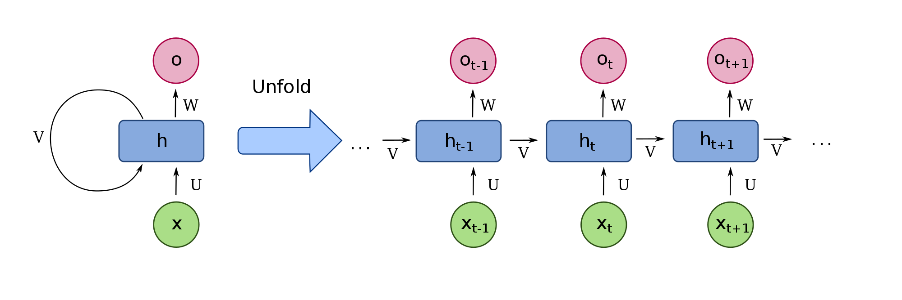

# Recurrent Neural Networks (RNN)

___

A recurrent neural network (RNN) is a type of neural network that has been succesful in modelling sequential data, e.g. language, speech, protein sequences, etc.

A RNN performs its computations in a cyclic manner, where the same computation is applied to every sample of a given sequence.
The idea is that the network should be able to use the previous computations as some form of memory and apply this to future computations.
An image may best explain how this is to be understood,

where it the network contains the following elements:

- $x$ is the input sequence of samples, 
- $U$ is a weight matrix applied to the given input sample,
- $V$ is a weight matrix used for the recurrent computation in order to pass memory along the sequence,
- $W$ is a weight matrix used to compute the output of the every timestep (given that every timestep requires an output),
- $h$ is the hidden state (the network's memory) for a given time step, and
- $o$ is the resulting output.

When the network is unrolled as shown, it is easier to refer to a timestep, $t$.
We have the following computations through the network:

- $h_t = f(U\,{x_t} + V\,{h_{t-1}})$, where $f$ is a non-linear activation function, e.g. $\mathrm{tanh}$.
- $o_t = W\,{h_t}$

When we are doing language modelling using a cross-entropy loss, we additionally apply the softmax function to the output $o_{t}$:

- $\hat{y}_t = \mathrm{softmax}(o_{t})$

## Long Short-term Memory

$$
\begin{array}{ll}
i_{t} = \sigma(W_{ii} x_{t} + b_{ii} + W_{hi} h_{t-1} + b_{hi}) \\
f_{t} = \sigma(W_{if} x_{t} + b_{if} + W_{hf} h_{t-1} + b_{hf}) \\
o_{t} = \sigma(W_{io} x_{t} + b_{io} + W_{ho} h_{t-1} + b_{ho}) \\
\tilde c_{t} = \tanh(W_{ic} x_{t} + b_{ic} + W_{hc} h_{t-1} + b_{hc}) \\
c_{t} = f_{t} \odot c_{t-1} + i_{t} \odot \tilde c_{t}  \\
h_{t} = o_{t} \odot \tanh(c_{t}) \\
\end{array}
$$

The LSTM cell contains three gates, input, forget, output gates and a memory cell.
The output of the LSTM unit is computed with the following functions, where $\sigma = \mathrm{softmax}$.
We have input gate $i$, forget gate $f$, and output gate $o$ defines as

- $i = \sigma ( W^i [h_{t-1}, x_t])$

- $f = \sigma ( W^f [h_{t-1},x_t])$

- $o = \sigma ( W^o [h_{t-1},x_t])$

where $W^i, W^f, W^o$ are weight matrices applied to a concatenated $h_{t-1}$ (hidden state vector) and $x_t$ (input vector)  for each respective gate.

$h_{t-1}$, from the previous time step along with the current input $x_t$ are used to compute the a candidate $g$

- $\tilde c_{t} = \mathrm{tanh}( W^g [h_{t-1}, x_t])$

The value of the cell's memory, $c_t$, is updated as

- $c_t = f \circ c_{t-1} + i \circ\tilde c_{t}  $

where $c_{t-1}$ is the previous memory, and $\circ$ refers to element-wise multiplication.

The output, $h_t$, is computed as

- $h_t = \mathrm{tanh}(c_t) \circ o$

and it is used for both the timestep's output and the next timestep, whereas $c_t$ is exclusively sent to the next timestep.
This makes $c_t$ a memory feature, and is not used directly to compute the output of the timestep.

## Forward pass

*Operation $z$ is the concatenation of $x$ and $h_{t-1}$*

### Concatenation of $h_{t-1}$ and $x_t$
$$
\begin{align}
z & = [h_{t-1}, x_t] \\
\end{align}
$$

### LSTM functions
$$
\begin{align}
f_t & = \sigma(W_f \cdot z + b_f) \\
i_t & = \sigma(W_i \cdot z + b_i) \\
\bar{C}_t & = tanh(W_C \cdot z + b_C) \\
C_t & = f_t * C_{t-1} + i_t * \bar{C}_t \\
o_t & = \sigma(W_o \cdot z + b_t) \\
h_t &= o_t * tanh(C_t) \\
\end{align}
$$

### Logits
$$
\begin{align}
v_t &= W_v \cdot h_t + b_v \\
\end{align}
$$

### Softmax

$$
\begin{align}
\hat{y_t} &= \text{softmax}(v_t)
\end{align}

$$

$\hat{y_t}$ is `y` in code and $y_t$ is `targets`.

## Backward pass

### Loss

$$
\begin{align}
L_k &= -\sum_{t=k}^T\sum_j y_{t,j} log \hat{y_{t,j}} \\
L &= L_1 \\
\end{align}
$$

### Gradients

$$
\begin{align}
dv_t &= \hat{y_t} - y_t \\
dh_t &= dh'_t + W_y^T \cdot dv_t \\
do_t &= dh_t * \text{tanh}(C_t) \\
dC_t &= dC'_t + dh_t * o_t * (1 - \text{tanh}^2(C_t))\\
d\bar{C}_t &= dC_t * i_t \\
di_t &= dC_t * \bar{C}_t \\
df_t &= dC_t * C_{t-1} \\
\\
df'_t &= f_t * (1 - f_t) * df_t \\
di'_t &= i_t * (1 - i_t) * di_t \\
d\bar{C}'_{t-1} &= (1 - \bar{C}_t^2) * d\bar{C}_t \\
do'_t &= o_t * (1 - o_t) * do_t \\
dz_t &= W_f^T \cdot df'_t \\
     &+ W_i^T \cdot di_t \\
     &+ W_C^T \cdot d\bar{C}_t \\
     &+ W_o^T \cdot do_t \\
\\
[dh'_{t-1}, dx_t] &= dz_t \\
dC'_t &= f_t * dC_t
\end{align}
$$

* $dC'_t = \frac{\partial L_{t+1}}{\partial C_t}$ and $dh'_t = \frac{\partial L_{t+1}}{\partial h_t}$
* $dC_t = \frac{\partial L}{\partial C_t} = \frac{\partial L_t}{\partial C_t}$ and $dh_t = \frac{\partial L}{\partial h_t} = \frac{\partial L_{t}}{\partial h_t}$
* All other derivatives are of $L$
* `target` is target character index $y_t$
* `dh_next` is $dh'_{t}$ (size H x 1)
* `dC_next` is $dC'_{t}$ (size H x 1)
* `C_prev` is $C_{t-1}$ (size H x 1)
* $df'_t$, $di'_t$, $d\bar{C}'_t$, and $do'_t$ are *also* assigned to `df`, `di`, `dC_bar`, and `do` in the **code**.
* *Returns* $dh_t$ and $dC_t$

### Model parameter gradients

$$
\begin{align}
dW_v &= dv_t \cdot h_t^T \\
db_v &= dv_t \\
\\
dW_f &= df'_t \cdot z^T \\
db_f &= df'_t \\
\\
dW_i &= di'_t \cdot z^T \\
db_i &= di'_t \\
\\
dW_C &= d\bar{C}'_t \cdot z^T \\
db_C &= d\bar{C}'_t \\
\\
dW_o &= do'_t \cdot z^T \\
db_o &= do'_t \\
\\
\end{align}
$$

## Gated Recurrent Unit

$$
\begin{array}{ll}
r_{t} = \sigma(W_{ir} x_{t} + b_{ir} + W_{hr} h_{t-1} + b_{hr}) \\
z_{t} = \sigma(W_{iz} x_{t} + b_{iz} + W_{hz} h_{t-1} + b_{hz}) \\
\tilde{h}_{t} = \tanh(W_{ih} x_{t} + b_{ih} + W(r_{t} \odot h_{t-1})) \\
h_{t} = (1 - z_{t}) \odot h_{t-1} + z_{t} \odot \tilde{h}_{t}
\end{array}
$$

参考：

http://ccolah.github.io/posts/2015-08-Understanding-LSTMs/

http://www.wildml.com/2015/10/recurrent-neural-networks-tutorial-part-3-backpropagation-through-time-and-vanishing-gradients/

http://github.com/crypto-code/Math-of-Neural-Networks