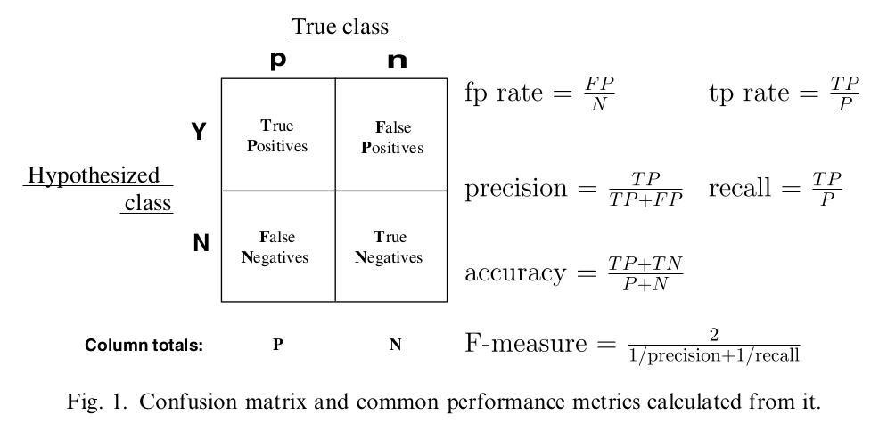
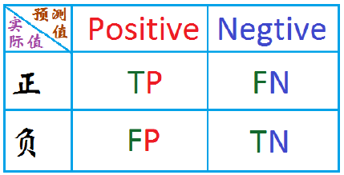
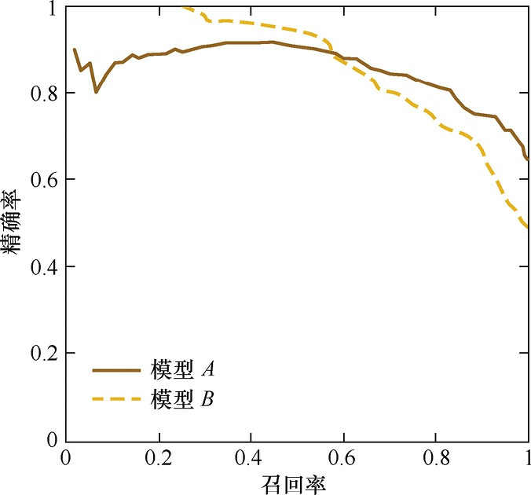

### 1. 简介

评价分类问题的性能的指标一般是分类准确率，其定义是对于给定的数据，分类正确的样本数占总样本数的比例。但是这一指标在Unbalanced的数据上表现很差。比如说我的样本有990个正样本，10个负样本，我直接把所有样本都预测为正，我的准确率为99%，居然有这么高得准确率，但我的分类方法实际是非常不具有说服力的。下面我们介绍分类问题的度量方法，精确率、召回率、F1、ROC、AUC、P-R曲线等；

### 2. 混淆矩阵表示

​     我们有4中情况，**把正例正确分类为正例，表示为TP（true positive），把正例错误分类为负例，表示为FN（false negative），把负例正确分类为负例，表示为TN（true negative）， 把负例错误分类为正例，表示为FP（false positive）**在混淆矩阵中表示如下：



***

选择另外一幅图说明：



#### 2.1 精确率、召回率和F1

**精确率**：$precison = \frac{TP}{TP+FP}$ **在所有预测为正例的数据中，真正例所占的比例**，又称查准率；

**召回率**: $recall= \frac{TP}{TP+FN}$,**指预测为真正例的数据占所有正例数据的比例**,又称查全率；

**F1**: $F1 = \frac{2}{\frac{1}{precision} + \frac{1}{recall}} $ ,  精确率和召回率的调和平均.

精确率是指分类正确的正样本个数占分类器判定为正样本的样本个数的比例。召回率是指分类正确的正样本个数占真正的正样本个数的比例。

**不同的分类问题，对精确率和召回率的要求也不同。**例如：假币预测，就需要很高的精确率，我需要你给我的预测数据具有很高的准确性。肿瘤预测就需要很高的召回率。“宁可错杀三千，不可放过一个”。

#### 2.2  P-R曲线

P-R曲线的横轴是召回率，纵轴是精确率。对于一个排序模型来说，其P-R曲线上的一个点代表着，在某一阈值下，模型将大于该阈值的结果判定为正样本，小于该阈值的结果判定为负样本，此时返回结果对应的召回率和精确率。整条P-R曲线是通过将阈值从高到低移动而生成的。下图图是P-R曲线样例图，其中实线代表模型A的P-R曲线，虚线代表模型B的P-R曲线。原点附近代表当阈值最大时模型的精确率和召回率。




由图可见，当召回率接近于0时，模型A的精确率为0.9，模型B的精确率是1，这说明模型B得分前几位的样本全部是真正的正样本，而模型A即使得分最高的几个样本也存在预测错误的情况。并且，随着召回率的增加，精确率整体呈下降趋势。但是，当召回率为1时，模型A的精确率反而超过了模型B。这充分说明，只用某个点对应的精确率和召回率是不能全面地衡量模型的性能，只有通过P-R曲线的整体表现，才能够对模型进行更为全面的评估。


#### 2.3 ROC曲线

ROC曲线是Receiver Operating Characteristic Curve的简称，中文名为“受试者工作特征曲线”。ROC曲线源于军事领域，而后在医学领域应用甚广，“受试者工作特征曲线”这一名称也正是来自于医学领域。

ROC曲线的横坐标为假阳性率（False Positive Rate，FPR）；纵坐标为真阳性率（True Positive Rate，TPR）。FPR和TPR的计算方法分别为：

真阳性率：$TPR = \frac{TP} {P} = \frac{TP}{TP+FN}$   **和召回率公式一致**；所有真实的“1”中，有多少被模型成功选出，即所有的刷单中，我们的策略能抓到多少；

假阳性率：$FPR = \frac{FP}{N} = \frac{TP}{FP+TN}$ 所有真实的“0”中，有多少被模型误判为1了，即所有的非刷单中，我们的策略误抓了多少；

上式中，P是真实的正样本的数量，N是真实的负样本的数量，TP是P个正样本中被分类器预测为正样本的个数，FP是N个负样本中被分类器预测为正样本的个数。

（1）ROC曲线图中的四个点
第一个点，(0,1)，即FPR=0, TPR=1，这意味着FN（false negative）=0，并且FP（false positive）=0。这是一个完美的分类器，它将所有的样本都正确分类。

第二个点，(1,0)，即FPR=1，TPR=0，类似地分析可以发现这是一个最糟糕的分类器，因为它成功避开了所有的正确答案。

第三个点，(0,0)，即FPR=TPR=0，即FP（false positive）=TP（true positive）=0，可以发现该分类器预测所有的样本都为负样本（negative）。

第四个点（1,1），分类器实际上预测所有的样本都为正样本。经过以上的分析，，ROC曲线越接近左上角，该分类器的性能越好。

（2）ROC曲线图中的一条特殊线
考虑ROC曲线图中的虚线y=x上的点。这条对角线上的点其实表示的是一个采用随机猜测策略的分类器的结果，例如(0.5,0.5)，表示该分类器随机对于一半的样本猜测其为正样本，另外一半的样本为负样本。

3 如何画ROC曲线
对于一个特定的分类器和测试数据集，每一个实例都会得到一个分类结果，通过统计，利用上述公式，可以得到一组FPR和TPR结果，而要得到一个曲线，实际上需要一系列FPR和TPR的值。那么这一系列值是怎么构造出来的呢？
在ROC曲线的定义中，有“as its discrimination threshold is varied.”这样一句话，而在本文最开始也提到了分类器的结果可以是“概率输出”，即表示分类器认为某个样本具有多大的概率属于正样本（或负样本），于是如果设置不同的threshold，那么分类结果就会有所变动，因此可以得到一系列FPR和TPR的值。
接下来就是利用python实现ROC曲线，sklearn.metrics有roc_curve, auc两个函数，本文主要就是通过这两个函数实现二分类和多分类的ROC曲线。

```
fpr, tpr, thresholds  =  roc_curve(y_test, scores) 
```

其中y_test为测试集的结果，scores为模型预测的测试集得分（注意：通过decision_function(x_test)计算scores的值）；fpr,tpr,thresholds 分别为假正率、真正率和阈值。（应该是不同阈值下的真正率和假正率）。

```
roc_auc =auc(fpr, tpr) 
```

其中roc_auc为计算的acu的值。


**AUC**:ROC曲线下的面积，引入AUC的原因是量化评价指标。

AUC面积越大，分类效果越好。AUC小于1，另一方面，正常的分类器你应该比随机猜测效果要好吧？所以 0.5 <= AUC <= 1

AUC表征了分类器把正样本排在负样本前边的能力。这里的意思其实是指数据按照其为正的概率从大到小排序之后，正样本排在负样本前边的能力。AUC越大，就有越多的正样本排在负样本前边。极端来看，如果ROC的(0, 1)点，所有的正样本都排在负样本的前边。

