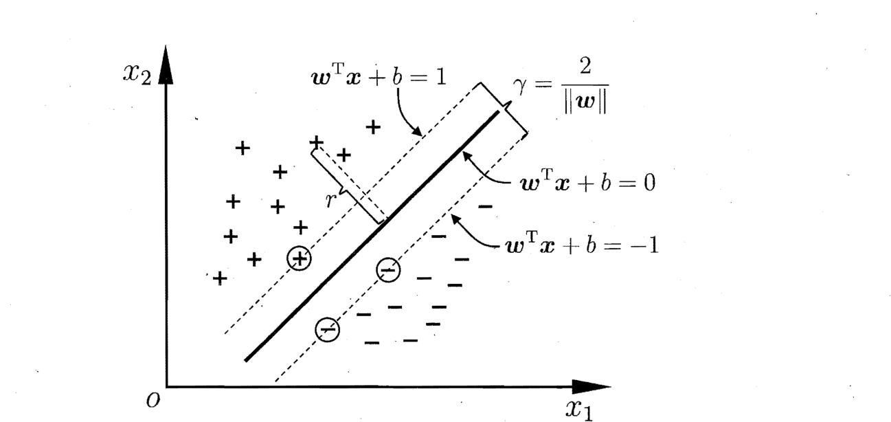

​      **支持向量机**，英文全名为**Support Vector Machine**(SVM)，和感知机算法一样它通常用于二分类样本数据的分类，不同之处在于感知机算法要求样本数据线性可分否则算法不收敛，而支持向量机算法通过引入核函数巧妙的解决了这个问题。支持向量机的基本思想是在样本数据中训练出一个间隔最大化的线性分类器，其学习策略为间隔最大化，最终转化为求解一个凸二次规划问题

#### 1. 支持向量机的目标函数

在样本空间中，划分超平面可以通过如下线性方程描述：
$$
w^Tx + b = 0 \label{1}
$$
其中，$w = (w_1;w_2;...;w_d)$为法向量，决定了超平面的方向；b为位移项，决定了超平面与原点之间的距离。显然，划分超平面可以被法向量$w$和$b$确定，下面我们将其记为$(w,b)$. 样本空间中任意点$x$到超平面$(w,b)$的距离可写为：
$$
r=\dfrac{\vert w^Tx+b\vert}{\Vert w\Vert} \label{2}
$$
假设超平面$(w,b)$能将训练样本正确分类，即对于$(x_i,y_i) \in D$,若$y_i=+1$,则有$w^Tx_i + b > 0$;若$y_i=-1$,则有$w^Tx_i + b < 0$,令
$$
\begin{aligned}
&w^Tx_{i}+b\geqslant 1,  & \forall y_{i}=1\\
& w^Tx_{i}+b\leqslant -1,  & \forall y_{i}=-1 
\end{aligned}
$$
如下图所示，距离超平面最近的这几个训练样本点使得上式等号成立，他们被称为“支撑向量（Support Vector)”,两个异类支撑向量到超平面的距离之和为：
$$
r=\frac{2}{\Vert w\Vert}
$$

欲找到具有“最大间隔（maximum margin）”的划分超平面，也就是要找到满足2式约束的参数$w$和$b$,故上述模型可以写成
$$
\begin{aligned}
&\mathop{\max}_{w,b}\ \dfrac{2}{\Vert w\Vert}\\
&s.t\ \ \ \ \ y_{i}(w ^Tx_{i}+b)\geqslant 1
\end{aligned}
$$
即
$$
\begin{aligned}
&\mathop{\min}_{w,b}\ \dfrac{1}{2}\Vert w\Vert^2\\
&s.t\ \ \ \ \ y_{i}(w ^Tx_{i}+b)\geqslant 1
\end{aligned}
$$
这个就是**支撑向量机的基本型。**

#### 2. 支持向量机算法的对偶问题

​	回到支持向量机的优化模型
$$
\begin{aligned}
&\mathop{\min}_{w,b}\ \dfrac{1}{2}\Vert w\Vert^2\\
&s.t\ \ \ \ \ y_{i}(w ^Tx_{i}+b)\geqslant 1
\end{aligned}
$$
由于该模型满足$\ KKT \ $条件，因此可以通过拉格朗日乘数法将有约束的优化目标转化为无约束的优化函数
$$
\begin{aligned}
\mathcal{L}(\omega,b,\alpha)&=\dfrac{1}{2}\Vert w\Vert^2-\sum\limits_{i=1}^m\alpha_i[y^{(i)}(w^Tx^{(i)}+b)-1]\\
s.t.\ \ &\alpha_i \geqslant0
\end{aligned}
$$
因此优化目标转化为
$$
\begin{aligned}
\mathop{\min}_{w,b} \mathop{\max}_{\alpha_i\geqslant0} \mathcal{L}(w,b,\alpha)
\end{aligned}
$$
该问题的对偶问题为
$$
\begin{aligned}
\mathop{\max}_{\alpha_i\geqslant0} \mathop{\min}_{w,b}  \mathcal{L}(w,b,\alpha)
\end{aligned}
$$
从上式中可以观察到先求优化函数对于$\ \omega,b\ $的极小值，然后再求拉格朗日乘子$\ \alpha_i\ $的极大值。首先为了求$\ \begin{aligned}\mathop{\min}_{\omega,b}  \mathcal{L}(\omega,b,\alpha)\end{aligned}\ $,可以通过对$\ \omega,b\ $分别求偏导数令其为$\ 0\ $得到
$$
\begin{aligned}
&\nabla_w\mathcal{L}(w,b,\alpha)=0\Rightarrow w=\sum\limits_{i=1}^m\alpha_iy^{(i)}x^{(i)}\\
&\nabla_b\mathcal{L}(w,b,\alpha)=0\Rightarrow \sum\limits_{i=1}^m\alpha_iy^{(i)}=0

\end{aligned}
$$
上面已经求出来的$\ \omega,\alpha\ $的关系，可以带入$\ \mathcal{L}(\omega,b,\alpha) \ $消去$\ \omega\ $，令$\ \phi(\alpha)=\begin{aligned}\mathop{\min}_{\omega,b}  \mathcal{L}(\omega,b,\alpha)\end{aligned}\ $则
$$
\begin{aligned}
\phi(\alpha)&=\dfrac{1}{2}\Vert w\Vert_2^2-\sum\limits_{i=1}^m\alpha_i[y^{(i)}(w^Tx^{(i)}+b)-1]\\

&=\sum\limits_{i=1}^m\alpha_i-\dfrac{1}{2}\sum\limits_{i=1,j=1}^m\alpha_i\alpha_jy^{(i)}y^{(j)}(x^{(i)})^Tx^{(j)}\\

\end{aligned}
$$
对$\ \phi(\alpha)\ $极大化的数学表达式如下：
$$
\begin{aligned}
&\mathop{\max}_{\alpha}\ \sum\limits_{i=1}^m\alpha_i-\dfrac{1}{2}\sum\limits_{i=1,j=1}^m\alpha_i\alpha_jy^{(i)}y^{(j)}(x^{(i)},x^{(j)})\\
&s.t.
\begin{cases} 
\sum\limits_{i=1}^m\alpha_iy^{(i)}=0\\
\alpha_i\geqslant0,i=1,2,\cdots,m
\end{cases}
\end{aligned}
$$
等价于求解如下极小化问题
$$
\begin{aligned}
&\mathop{\min}_{\alpha}\ \dfrac{1}{2}\sum\limits_{i=1,j=1}^m\alpha_i\alpha_jy^{(i)}y^{(j)}(x^{(i)},x^{(j)})-\sum\limits_{i=1}^m\alpha_i\\
&s.t.
\begin{cases} 
\sum\limits_{i=1}^m\alpha_iy^{(i)}=0\\
\alpha_i\geqslant0,i=1,2,\cdots,m
\end{cases}
\end{aligned}
$$

#### 3. SMO算法

​	假设输入空间是$\ X\in\R^{n} \ $,$\ Y\in\{+1,-1\}\ $，不妨假设含有$m$个样本数据($x^{(1)}$,$y^{(1)}$)、($x^{(2)}$,$y^{(2)}$)、$\cdots$、($x^{(m)}$,$y^{(m)}$)，其中$x^{(i)}\in X、y^{(i)}\in Y \ $，精度为$\ \varepsilon\ $，输出近似解为$\ \widehat{\alpha} \ $；

1. 取初值$\ \alpha^0=0\ $，令$\ k=0\ $

2. 选取待优化变量$\ \alpha_1^k、\alpha_2^k\ $，计算出新的$\ \alpha_2^{new,unr}\ $
   $$
   \alpha_2^{new,unr}=\alpha_2^{old}+\dfrac{y^{(2)}(E^{(1)}-E^{(2)})}{k_{1,1}-2k_{1,2}+k_{2,2}}
   $$

3. 更新$\ \alpha_2^{k+1}\ $
   $$
   \begin{aligned}
   \alpha_2^{k+1}
   =
   \begin{cases}
   H, & \alpha_2^{new,unr}\gt H\\
   \alpha_2^{new,unr}, & L\leqslant\alpha_2^{new,unr}\leqslant H\\
   L,& \alpha_2^{new,unr}<L
   \end{cases}
   \end{aligned}
   $$

4. 利用$\ \alpha_1^{k+1}\ $和$\ \alpha_2^{k+1}\ $的关系求出$\ \alpha_1^{k+1}\ $
   $$
   \alpha_1^{k+1}=\alpha_1^{k}+y^{(1)}y^{(2)}(\alpha_2^{k}-\alpha_2^{k+1})
   $$

5. 计算$\ b^{k+1}\ $和$\ E_i\ $

6. 在精度$\ \varepsilon\ $范围内检查是否满足如下的终止条件，其中$\ f(x^{(i)})=\sum\limits_{j=1}^m\alpha_jy^{(j)}k_{j,i}+b \ $ 
   $$
   \begin{aligned}
   &\begin{cases}
   \sum\limits_{i=1}^m\alpha_iy^{(i)}=0,\\
   0\leqslant\alpha_i\leqslant C,i=1,2,\cdots,m
   \end{cases}\\
   \\
   &\begin{cases}
   \alpha_i^{k+1}=0\Longleftrightarrow y^{(i)}f(x^{(i)})\geqslant1,\\
   \alpha_i^{k+1}=C\Longleftrightarrow y^{(i)}f(x^{(i)})\leqslant1,\\
   0\lt \alpha_i^{k+1}\lt C\Longleftrightarrow y^{(i)}f(x^{(i)})=1,
   
   \end{cases}
   \end{aligned}
   $$
   若满足则转$\ 7\ $；否则令$\ k=k+1 \ $转到步骤$\ 2\ $；

7. 取$\ \widehat{\alpha}=\alpha^{k+1} \ $。

#### 4. 面试相关问题

##### 4.1 SVM为什么可以分类非线性问题？

原输入空间是一个非线性可分问题，能用一个超曲面将正负例正确分开；

通过核技巧的非线性映射，将输入空间的超曲面转化为特征空间的超平面，原空间的非线性可分问题就变成了新空间的的线性可分问题。低维映射到高维。

在核函数 $K(x,z)$ 给定的条件下，可以利用解线性分类问题的方法求解非线性分类问题的支持向量机。学习是隐式地在特征空间进行的，在学习和预测中只定义核函数 $K(x,z)$，而不需要显式地定义特征空间和映射函数$\phi$，这样的技巧成为核技巧。通常直接计算$K(x,z)$比较容易，而通过$\phi(x)$和$\phi(z)$计算$K(x,z)$并不容易。

对于给定核 $K(x,z)$，特征空间和映射函数的取法并不唯一。

##### 4.2 多分类问题

1. 某些算法原生的支持多分类，如：决策树、最近邻算法等。但是有些算法只能求解二分类问题，如：支持向量机。
2. 对于只能求解二分类问题的算法，一旦遇到问题是多类别的，那么可以将多分类问题拆解成二分类任务求解。
   - 先对原问题进行拆分，然后为拆出的每个二分类任务训练一个分类器。
   - 测试时，对这些二分类器的预测结果进行集成，从而获得最终的多分类结果。
3. 多分类问题有三种拆解方式：
   - 一对其余(`One-vs-rest:OvR`) :为每一对类别训练一个分类器。
   - 一对一(`one-vs-one:OvO`) :训练k(k-1)个分类器
   - 多对多(`many-vs-many:MvM`) 。

##### 4.3  当用支持向量机进行分类时，支持向量越多越好还是越少越好?

结论：在$n$维特征空间中，线性SVM一般会产生$n+1$个支持向量（不考虑退化情况） 

通常的SVM的使用会伴随着核技巧（kernel），这用于将低维空间映射到一个更高维的空间，使得原本不线性可分的数据点变得在高维空间中线性可分。虽然这种映射是隐式的，我们通常并不知道映射到的空间是什么样子。但是根据之前的结论，我们可以认为如果训练出来的SVM有d+1个支持向量，这个kernel在这个任务里就讲原来的数据映射到了一个d维的空间中，并使得其线性可分。

更高的维度通常意味着更高的模型复杂度，所以支持向量越多，表示着训练得到的模型越复杂。根据泛化理论，这意味着更有过拟合的风险。

 如果在性能一致的情况下，更少的支持向量可能是更好的。但是这一点其实不绝对，因为泛化理论仅仅是误差的上界，实际的泛化情况的决定因素比较复杂，也可能取决于kernel的性质。所以还是自己做cross validation比较好。

##### 4.4 **为什么要将求解SVM的原始问题转换为其对偶问题？**

1. 对偶问题往往更易求解（当我们寻找约束存在时的最优点的时候，约束的存在虽然减小了需要搜寻的范围，但是却使问题变得更加复杂。为了使问题变得易于处理，我们的方法是把目标函数和约束全部融入一个新的函数，即拉格朗日函数，再通过这个函数来寻找最优点。）
2. 自然引入核函数，进而推广到非线性分类问题....

### 5. SVM损失函数

#### 5.1 Hinge Loss Function

$$
c(x, y, f(x)) = (1 - y * f(x))_+
$$

其中$c$ 是损失函数, $x$ 是样本, $y$ 是实际目标列, $f(x)$ 是预测目标列。

上式也可以写成:
$$
c(x, y, f(x))= 
\begin{cases}
    0,& \text{if } y*f(x)\geq 1\\
    1-y*f(x),              & \text{else}
\end{cases}
$$

#### 5.2 目标函数 

Svm的目标函数如下:
$$
\underset{w}{min}\ \lambda\parallel w\parallel^2 + \ \sum_{i=1}^n\big(1-y_i \langle x_i,w \rangle\big)_+
$$
其中第一项是正则化项, 第二项是损失。

#### 5.3 目标函数的导数

最小化目标函数，我们需要对目标函数求导：

我们分别对目标函数的两项求导如下：
$$
\frac{\delta}{\delta w_k} \lambda\parallel w\parallel^2 \ = 2 \lambda w_k
$$

$$
\frac{\delta}{\delta w_k} \big(1-y_i \langle x_i,w \rangle\big)_+ \ = \begin{cases}
    0,& \text{if } y_i \langle x_i,w \rangle\geq 1\\
    -y_ix_{ik},              & \text{else}
\end{cases}
$$

if $y_i⟨x_i,w⟩ < 1$:
$$
w = w + \eta (y_ix_i - 2\lambda w)
$$
else:
$$
w = w + \eta (-2\lambda w)
$$

