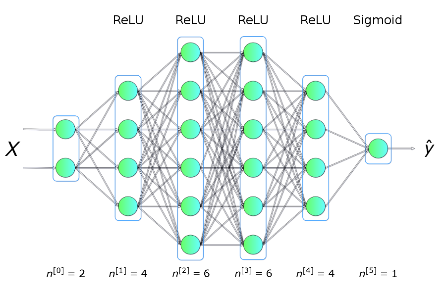
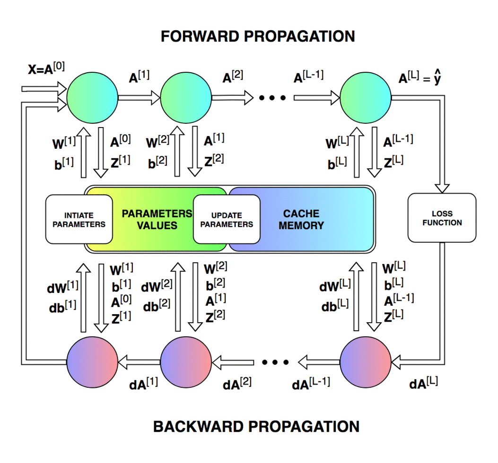
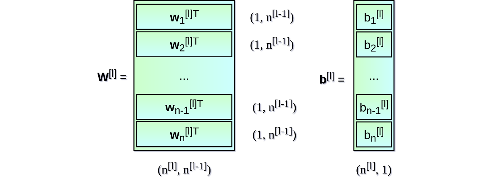
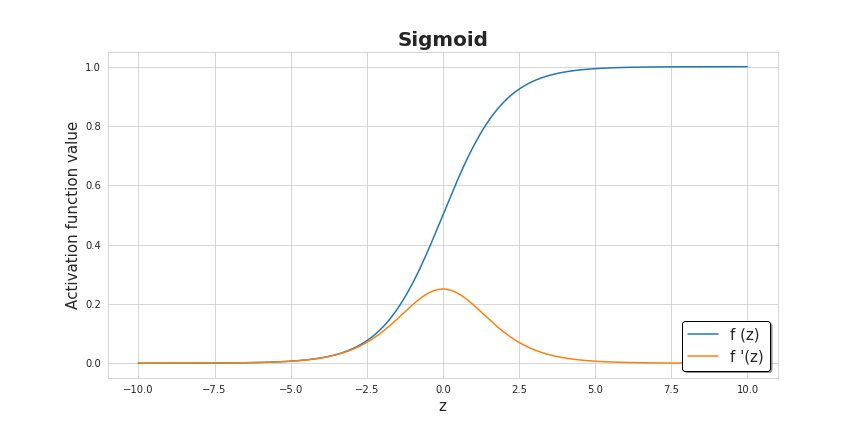
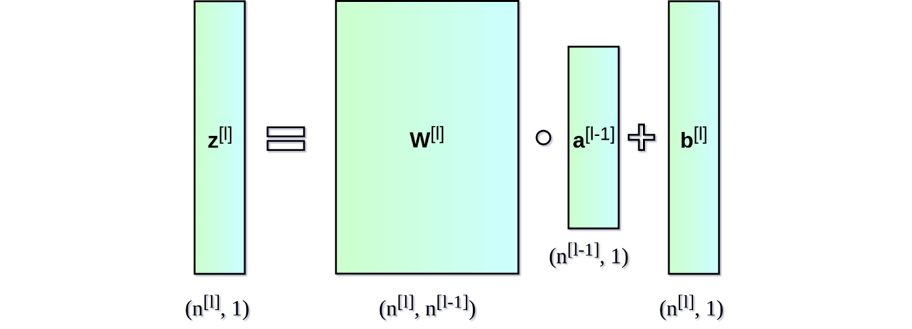
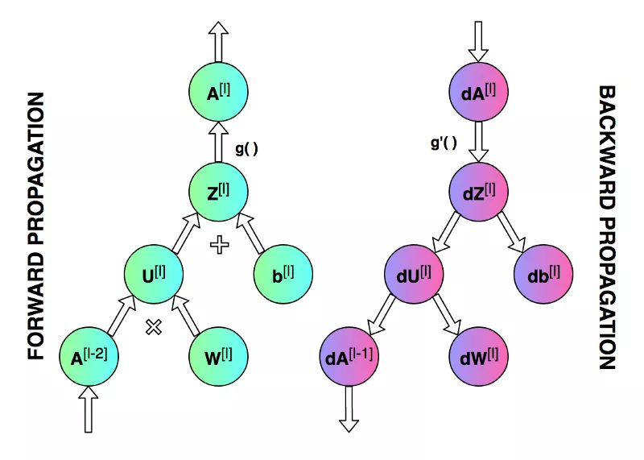

### 神经网络的numpy实现和公式推导


​       过去10多年是神经网络发展的黄金时期，神经网络(深度学习)成为了新时代的一种浪潮，所以今天借用国外一个小哥实现纯numpy的神经网络，来记录神经网络的实现过程。




#### 概览

​        在开始编程之前，先让我们准备一份基本的路线图。我们的目标是创建一个特定架构（层数、层大小、激活函数）的密集连接神经网络。然后训练这一神经网络并做出预测。



上面的示意图展示了训练网络【特别是正向传播和反向传播的操作】时进行的操作，以及单次迭代不同阶段需要更新和读取的参数。

#### 初始化神经网络层

  让我们从初始化每一层的权重矩阵$W$和偏置向量$b$开始。下图展示了网络层l的权重矩阵和偏置向量，其中，上标$[l]$表示当前层的索引，$n$表示给定层中的神经元数量。



我们的程序也将以类似的列表形式描述神经网络架构。列表的每一项是一个字典，描述单个网络层的基本参数：`input_dim`是网络层输入的信号向量的大小，`output_dim`是网络层输出的激活向量的大小，`activation`是网络层所用的激活函数。

```python
nn_architecture = [
    {"input_dim": 2, "output_dim": 4, "activation": "relu"},
    {"input_dim": 4, "output_dim": 6, "activation": "relu"},
    {"input_dim": 6, "output_dim": 6, "activation": "relu"},
    {"input_dim": 6, "output_dim": 4, "activation": "relu"},
    {"input_dim": 4, "output_dim": 1, "activation": "sigmoid"},
]
```

值得注意的是，一个网络层的输出向量同时也是下一层的输入。

```python
def init_layers(nn_architecture, seed = 99):
    np.random.seed(seed)
    number_of_layers = len(nn_architecture)
    params_values = {}

    for idx, layer in enumerate(nn_architecture):
        layer_idx = idx + 1
        layer_input_size = layer["input_dim"]
        layer_output_size = layer["output_dim"]

        params_values['W' + str(layer_idx)] = np.random.randn(
            layer_output_size, layer_input_size) * 0.1
        params_values['b' + str(layer_idx)] = np.random.randn(
            layer_output_size, 1) * 0.1

    return params_values
```

​        上面的代码初始化了网络层的参数。注意我们用随机的小数字填充矩阵**W**和向量**b**。这并不是偶然的。权重值无法使用相同的数字初始化，否则会造成**破坏性的对称问题**。**基本上，如果权重都一样，不管输入X是什么，隐藏层的所有单元也都一样**。这样，我们就会陷入初始状态，不管训练多久，网络多深，都无望摆脱。线性代数不会原谅我们。

[^初始化方法包含很多种，我们这里简便起见，使用随机初始化的方式生成权重]: 

​       小数值增加了算法的效率。我们可以看看下面的sigmoid函数图像，大数值处的函数图像几乎是扁平的，这会对神经网络的学习速度造成显著影响。所有参数使用小随机数是一个简单的方法，但它保证了算法有一个**足够好**的开始。



#### 激活函数

​        激活函数只需一行代码就可以定义，但它们给神经网络带来了非线性和所需的表达力。**“没有它们，神经网络将变成线性函数的组合，也就是单个线性函数。”**激活函数有很多种，但在这个项目中，我决定使用其中两种——sigmoid和ReLU。为了同时支持前向传播和反向传播，我们还需要准备好它们的导数。

```python
def sigmoid(Z):
    return 1/(1+np.exp(-Z))

def relu(Z):
    return np.maximum(0,Z)

def sigmoid_backward(dA, Z):
    sig = sigmoid(Z)
    return dA * sig * (1 - sig)

def relu_backward(dA, Z):
    dZ = np.array(dA, copy = True)
    dZ[Z <= 0] = 0;
    return dZ;
```

#### 前向传播

​    我们设计的神经网络有一个简单的架构。输入矩阵**X**传入网络，沿着隐藏单元传播，最终得到预测向量**Y_hat**。为了让代码更易读，我将前向传播拆分成两个函数——单层前向传播，和整个神经网络前向传播。

​	    **前向传播的过程是：输入$a^{[l-1]}$, 输出$a^{[l]}$, 缓存为$z^{[l]}$,  从方便实现的角度上看，$z^{[l]}$是$w^{[l]}$，$b^{[l]}$的函数。**

```python
def single_layer_forward_propagation(A_prev, W_curr, b_curr, activation="relu"):
    Z_curr = np.dot(W_curr, A_prev) + b_curr
    if activation is "relu":
        activation_func = relu
    elif activation is "sigmoid":
        activation_func = sigmoid
    else:
        raise Exception('Non-supported activation function')

    return activation_func(Z_curr), Z_curr
```
这部分代码大概是最直接，最容易理解的。给定来自上一层的输入信号，我们计算仿射变换**Z**，接着应用选中的激活函数。基于NumPy，我们可以对整个网络层和整批样本一下子进行矩阵操作，无需迭代，这大大加速了计算。除了计算结果外，函数还返回了一个反向传播时需要用到的中间值**Z**。



基于单层前向传播函数，编写整个前向传播步骤很容易。这是一个略微复杂一点的函数，它的角色不仅是进行预测，还包括组织中间值。
$$
\begin{aligned}
z^{[l]} = w^{[l]}a^{[l-1]} + b^{[l]}  \\

a^{[l]} = g^{[l]}(z^{[l]})
\end{aligned}
$$


```python
def full_forward_propagation(X, params_values, nn_architecture):
    memory = {}
    A_curr = X

    for idx, layer in enumerate(nn_architecture):
        layer_idx = idx + 1
        A_prev = A_curr

        activ_function_curr = layer["activation"]
        W_curr = params_values["W" + str(layer_idx)]
        b_curr = params_values["b" + str(layer_idx)]
        A_curr, Z_curr = single_layer_forward_propagation(A_prev, W_curr, b_curr, activ_function_curr)

        memory["A" + str(idx)] = A_prev
        memory["Z" + str(layer_idx)] = Z_curr

    return A_curr, memory
```

#### 损失函数

​          损失函数可以监测进展，确保我们向着正确的方向移动。**“一般来说，损失函数是为了显示我们离‘理想’解答还有多远。”**损失函数根据我们计划解决的问题而选用，Keras之类的框架提供了很多选项。因为我计划将神经网络用于二元分类问题，我决定使用交叉熵：
$$
J(W,b) = \dfrac{1}{m}{\sum}_{i=1}^{m}L(\hat{y}^{i} - y^{i})  \\
L(\hat{y} - y) = -(ylog\hat{y} + (1-y)log(1-\hat{y}))
$$
为了取得更多关于学习过程的信息，我决定另外实现一个计算精确度的函数。

```python
'''
J(W,b) = 1/m sum_{i}^{m}L(y^{hat}_{i} - y_{i})
L(y^{hat}_{i} - y_{i}) = -(ylogy^{hat} + (1-y)log(1-y^{hat}))
'''

def get_cost_value(Y_hat, Y):
    m = Y_hat.shape[1]
    cost = -1 / m * (np.dot(Y, np.log(Y_hat).T) + np.dot(1 - Y, np.log(1 - Y_hat).T))
    return np.squeeze(cost)

# an auxiliary function that converts probability into class
def convert_prob_into_class(probs):
    probs_ = np.copy(probs)
    probs_[probs_ > 0.5] = 1
    probs_[probs_ <= 0.5] = 0
    return probs_

def get_accuracy_value(Y_hat, Y):
    Y_hat_ = convert_prob_into_class(Y_hat)
    return (Y_hat_ == Y).all(axis=0).mean()
```

#### 反向传播

不幸的是，很多缺乏经验的深度学习爱好者都觉得反向传播很吓人，难以理解。微积分和线性代数的组合经常会吓退那些没有经过扎实的数学训练的人。所以不要过于担心你现在还不能理解这一切。相信我，我们都经历过这个过程。

```python
def single_layer_backward_propagation(dA_curr, W_curr, b_curr, Z_curr, A_prev, activation="relu"):
    # number of examples
    m = A_prev.shape[1]
    
    # selection of activation function
    if activation is "relu":
        backward_activation_func = relu_backward
    elif activation is "sigmoid":
        backward_activation_func = sigmoid_backward
    else:
        raise Exception('Non-supported activation function')
    
    # calculation of the activation function derivative
    dZ_curr = backward_activation_func(dA_curr, Z_curr)
    
    # derivative of the matrix W
    dW_curr = np.dot(dZ_curr, A_prev.T) / m
    # derivative of the vector b
    db_curr = np.sum(dZ_curr, axis=1, keepdims=True) / m
    # derivative of the matrix A_prev
    dA_prev = np.dot(W_curr.T, dZ_curr)

    return dA_prev, dW_curr, db_curr

```

​        人们经常搞混反向传播和梯度下降，但事实上它们不一样。前者是为了高效地计算梯度，后者则是为了基于计算出的梯度进行优化。在神经网络中，我们计算损失函数在参数上的梯度，但反向传播可以用来计算任何函数的导数。**反向传播算法的精髓在于递归地使用求导的链式法则，通过组合导数已知的函数，计算函数的导数**。下面的公式描述了单个网络层上的反向传播过程。由于本文的重点在实际实现，所以我将省略求导过程。从公式上我们可以很明显地看到，为什么我们需要在前向传播时记住中间层的**A**、**Z**矩阵的值。

$$\boldsymbol{dW}^{[l]} = \frac{\partial L }{\partial \boldsymbol{W}^{[l]}} =\frac{\partial L }{\partial \boldsymbol{Z}^{[l]}} \frac{\partial \boldsymbol{Z}^{[l]} }{\partial \boldsymbol{W}^{[l]}} =  \frac{1}{m} \boldsymbol{dZ}^{[l]} \boldsymbol{A}^{[l-1] T}$$

$$\boldsymbol{db}^{[l]} = \frac{\partial L }{\partial \boldsymbol{b}^{[l]}}  = \frac{\partial L }{\partial \boldsymbol{Z}^{[l]}}   \frac{\partial \boldsymbol{Z}^{[l]} }{\partial \boldsymbol{b}^{[l]}}= \frac{1}{m} \sum_{i = 1}^{m} \boldsymbol{dZ}^{[l](i)}$$

$$\boldsymbol{dA}^{[l-1]} = \frac{\partial L }{\partial \boldsymbol{A}^{[l-1]}} =  \frac{\partial L }{\partial \boldsymbol{Z}^{[l]}}  \frac{\partial \boldsymbol{Z}^{[l]} }{\partial \boldsymbol{A}^{[l-1]}} = \boldsymbol{W}^{[l] T} \boldsymbol{dZ}^{[l]}$$

$$\boldsymbol{dZ}^{[l]} = \frac{\partial L }{\partial \boldsymbol{Z}^{[l]}}= \frac{\partial L }{\partial \boldsymbol{A}^{[l]}} \frac{\partial {A}^{[l]} }{\partial \boldsymbol{Z}^{[l]}}=\boldsymbol{dA}^{[l]} * g^{[l]}{'}(\boldsymbol{Z}^{[l]})$$



和前向传播一样，我决定将计算拆分成两个函数。之前给出的是单个网络层的反向传播函数，基本上就是以NumPy方式重写上面的数学公式。而定义完整反向传播过程的函数，主要是读取、更新三个字典中的值。

```python
def full_backward_propagation(Y_hat, Y, memory, params_values, nn_architecture):
    grads_values = {}
    
    # number of examples
    m = Y.shape[1]
    # a hack ensuring the same shape of the prediction vector and labels vector
    Y = Y.reshape(Y_hat.shape)
    
    # initiation of gradient descent algorithm
    dA_prev = - (np.divide(Y, Y_hat) - np.divide(1 - Y, 1 - Y_hat));
    
    for layer_idx_prev, layer in reversed(list(enumerate(nn_architecture))):
        # we number network layers from 1
        layer_idx_curr = layer_idx_prev + 1
        # extraction of the activation function for the current layer
        activ_function_curr = layer["activation"]
        
        dA_curr = dA_prev
        
        A_prev = memory["A" + str(layer_idx_prev)]
        Z_curr = memory["Z" + str(layer_idx_curr)]
        
        W_curr = params_values["W" + str(layer_idx_curr)]
        b_curr = params_values["b" + str(layer_idx_curr)]
        
        dA_prev, dW_curr, db_curr = single_layer_backward_propagation(
            dA_curr, W_curr, b_curr, Z_curr, A_prev, activ_function_curr)
        
        grads_values["dW" + str(layer_idx_curr)] = dW_curr
        grads_values["db" + str(layer_idx_curr)] = db_curr
    
    return grads_values
```

基于单个网络层的反向传播函数，我们从最后一层开始迭代计算所有参数上的导数，并最终返回包含所需梯度的python字典。


#### 更新参数值

反向传播是为了计算梯度，以根据梯度进行优化，更新网络的参数值。为了完成这一任务，我们将使用两个字典作为函数参数：`params_values`，其中保存了当前参数值；`grads_values`，其中保存了用于更新参数值所需的梯度信息。现在我们只需在每个网络层上应用以下等式即可。这是一个非常简单的优化算法，但我决定使用它作为更高级的优化算法的起点（大概会是我下一篇文章的主题）。

$$\boldsymbol{W}^{[l]} = \boldsymbol{W}^{[l]} - \alpha \boldsymbol{dW}^{[l]} $$

$$\boldsymbol{b}^{[l]} = \boldsymbol{b}^{[l]} - \alpha \boldsymbol{b}^{[l]} $$

```
def update(params_values, grads_values, nn_architecture, learning_rate):

    # iteration over network layers
    for layer_idx, layer in enumerate(nn_architecture, 1):
        params_values["W" + str(layer_idx)] -= learning_rate * grads_values["dW" + str(layer_idx)]        
        params_values["b" + str(layer_idx)] -= learning_rate * grads_values["db" + str(layer_idx)]

    return params_values;
```

#### 整合一切

万事俱备只欠东风。最困难的部分已经完成了——我们已经准备好了所需的函数，现在只需以正确的顺序把它们放到一起。

```python
def train(X, Y, nn_architecture, epochs, learning_rate, verbose=False, callback=None):
    # initiation of neural net parameters
    params_values = init_layers(nn_architecture, 2)
    # initiation of lists storing the history 
    # of metrics calculated during the learning process 
    cost_history = []
    accuracy_history = []
    
    # performing calculations for subsequent iterations
    for i in range(epochs):
        # step forward
        Y_hat, cashe = full_forward_propagation(X, params_values, nn_architecture)
        
        # calculating metrics and saving them in history
        cost = get_cost_value(Y_hat, Y)
        cost_history.append(cost)
        accuracy = get_accuracy_value(Y_hat, Y)
        accuracy_history.append(accuracy)
        
        # step backward - calculating gradient
        grads_values = full_backward_propagation(Y_hat, Y, cashe, params_values, nn_architecture)
        # updating model state
        params_values = update(params_values, grads_values, nn_architecture, learning_rate)
        
        if(i % 50 == 0):
            if(verbose):
                print("Iteration: {:05} - cost: {:.5f} - accuracy: {:.5f}".format(i, cost, accuracy))
            if(callback is not None):
                callback(i, params_values)
            
    return params_values
```


