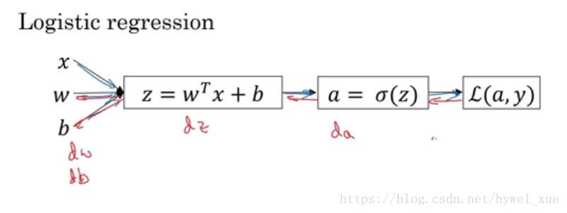
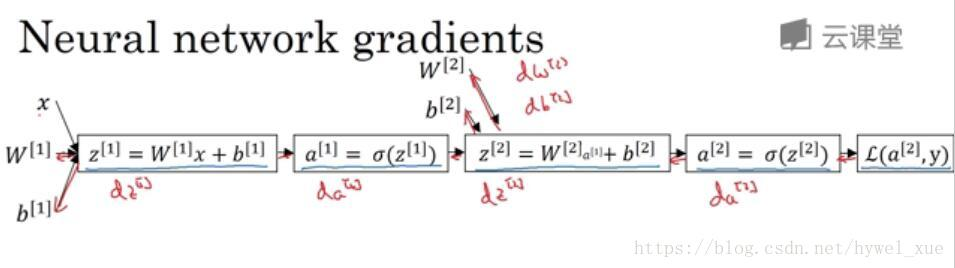
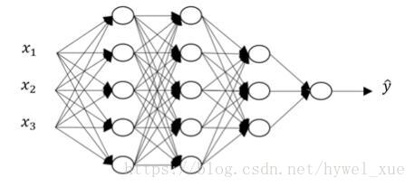
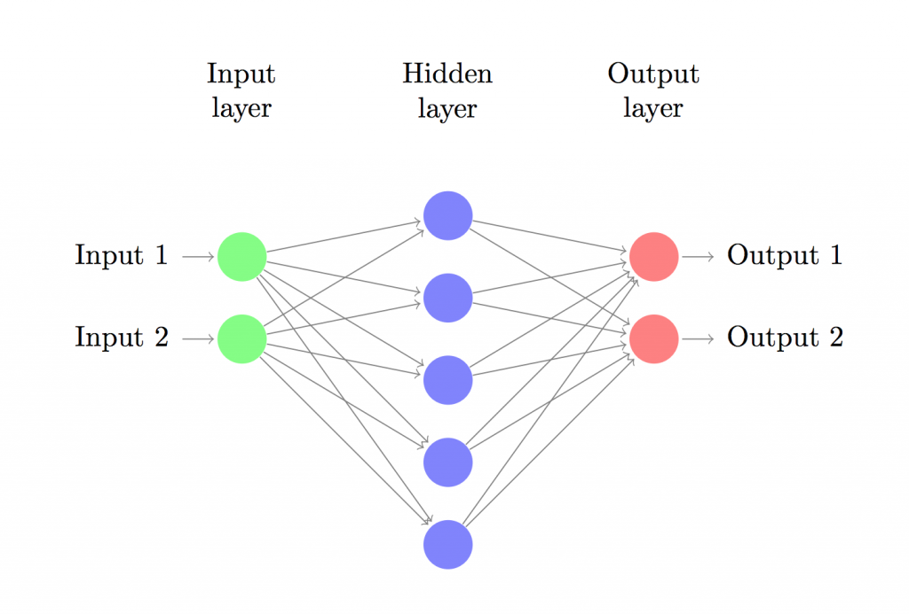

#### 神经网络的反向传播公式

##### 1. 逻辑回归反向传播公式的推导

逻辑回归是最简单的神经网络，先入手逻辑回归，有助于后面的理解。

上图是一个逻辑回归正向传播的示意图。具体细节不再描述。

损失函数为：
$$
L(a,y) = -yloga -(1-y)log(1-a)
$$
反向传播的目的为了求$dw和db$，从而采用梯度下降法进行迭代优化，那么反向传播就是从后向前一步步的求微分，从而得到$dw,db$,具体过程如下：

1.  $da = \frac{dL(a,y)}{da} = -\frac{y}{a} + \frac{1-y}{1-a}$
2.  $dz = \frac{dL(a,y)}{dz} = \frac{dL}{da} \frac{da}{dz}= da.g^{'}(z) = a - y$，其中sigmoid函数导数计算公式$g^{'}(z) = g(z)(1-g(z))$
3. $dw = dz.x$
4. $db = dz$

这样就完成了逻辑回归的反向传播

##### 2. 单隐层神经网络的反向传播公式推导

神经网络计算中，与逻辑回归十分相似，但中间会有多层计算。下图是一个双层神经网络，有一个输入层，一个隐藏层和一个输出层。 

前向传播如图所示。其中$L(a^{[2]},y)$为交叉熵损失函数，假设有两个输出则：
$$
L(a^{[2]},y) = -yloga^{[2]} -(1-y)log(1-a^{[2]})
$$
反向传播公式如下：

$da^{[2]} = \frac{dL(a^{[2]},y)}{da} = -\frac{y}{a^{[2]}} + \frac{1-y}{1-a^{[2]}}$

1.  $dz^{[2]} = \frac{dL(a,y)}{dz^{[2]}} = \frac{dL}{da^{[2]}} \frac{da^{[2]}}{dz^{[2]}}= da^{[2]}.g^{'}(z^{[2]}) = a^{[2]} - y$，其中sigmoid函数导数计算公式$g^{'}(z) = g(z)(1-g(z))$
2. $dw ^{[2]}= dz^{[2]}.(a^{[1]})^T$
3. $db^{[2]} = dz^{[2]}$
4. $dz^{[1]} = \frac{dL}{da^{[1]}}\frac{da^{[1]}}{dz^{[1]}}  = (w^{[2]})^Tdz^{[2]}*(g^{[1]})^{'}(z^{[1]})$
5. $dw^{[1]} = dz^{[1]}.x^T$
6. $db^{[1]} = dz^{[1]}$

##### 3. 深层神经网络的前向和反向传播

下面是一个四层的神经网络：

前向传播过程：
$$
\begin{aligned}
z^{[l]} &= w^{[l]}a^{[l-1]} + b^{[l]} \\
a^{[l]} &= g^{[l]}(z^{[l]})
\end{aligned}
$$
与单隐层神经网络反向传播类似，我们可以直接写出深层神经网络的反向传播递推公式：
$$
\begin{aligned}
\mathrm{d}z^{[l]} &= \mathrm{d}a^{[l]} \cdot g^{[l]'}(z^{[l]}) \\
\mathrm{d}w^{[l]} &= \mathrm{d}z^{[l]} \cdot a^{[l-1]} \\
\mathrm{d}b^{[l]} &= \mathrm{d}z^{[l]} \\
\mathrm{d}a^{[l-1]} &= w^{[l]^T} \cdot \mathrm{d}z^{[l]}
\end{aligned}
$$

**NOTE:上面由于前向传播使用的$WX$,导致使用正常样本时，需要将$X$取转置设置，很是不爽，于是在下面给出$XW$的情形**。

这里只关注单隐层的情形：

输入层，隐藏层，输出层。输入层的节点数目由数据集的维度决定（我们的数据集是2：x和y），同样的，输出层的节点数目也取决于数据集中的类别(同样是2：0和1)。值得注意的是：2个类别可以用1个节点来表示，但考虑到网络的扩展性，我们将输出节点的数目定为2。网络的输入是(x,y)坐标，输出是0或者1。用图片表示的话网络结构如下：

隐藏层的维度（节点数）是可以设置的，节点越多，能够匹配的函数模型越复杂。但这也会耗费更多的计算资源，也会增加过拟合的可能性。隐藏层大小的设定更像是一门艺术，它需要根据问题的具体情况进行分析。稍后我们将分析隐藏层节点的个数是如何对我们的输出进行影响的。

除此之外，我们还需要为隐藏层选择一个合适的激活函数。激活函数用来将该层的输入转化为输出。非线性的激活函数能够让我们做一些非线性的假设。常用的非线性激活函数有：$tanh/sigmoid/ReLU$等。本文中使用的激活函数是tanh（我个人建议用ReLU），这个激活函数的有效性也经过了很多方案的验证。一个好的激活函数具有以下性质：保证数据输入与输出也是可微的。比如说$dtanh(x)/dx = 1-（tanh(x)*tanh(x)）$。这样可以保证我们只计算一次tanh(x)的值就可以用在之后的计算导数过程中。

为了使网络的输出是一个概率，所以输出层的激活函数就只能是softmax（逻辑回归只能输出二分类而softmax可以输出多个分类），这里用softmax的原因是它可以将分数转化为概率。

**神经网络如何预测**

我们设计的神经网络通过前向传播来进行预测，可以简单的将前向传播理解为一系列的矩阵乘法运算和使用激活函数的结果。如果输入$x$代表一个二维向量，那么我们计算输出$\hat{y}$（同样也是二维）的方法如下：
$$
\begin{aligned}
z_1 &= xW_1 + b_1 \\
a_1 &= tanh(z_1) \\
z_2 &= a_1W_2 + b_2 \\
a_2 &= \hat{y} = softmax(z_2) \\
\end{aligned}
$$
$z_i$ 代表第$i$层的输入，$a_i$ 代表第$i$层应用激活函数后的输出 。$W_1,b_1,W_2,b_2$ 是网络的一些参数，具体的值需要通过训练数据来得到，你可以把他们看作层与层之间的矩阵变化数据。 矩阵的维度可以通过上述的矩阵乘法得到。举例说明：当我们使用的隐藏层有100个节点时，那么就有$W_1 \in \mathbb{R}^{2 \times 100},b_1 \in \mathbb{R}^{100},W_2 \in \mathbb{R}^{100*2},b_2 \in \mathbb{R}^2$,这也可以解释为什么当节点数量增加时计算量也会随之增加。

**参数的学习过程**

参数学习是指神经网络寻找能使训练数据误差最小的$W_1, b_1, W_2, b_2$值的过程。我们把衡量误差的函数叫做损失函数。当输出通过$softmax$得到时，常用的损失函数分类交叉熵损失（也叫负对数似然函数）。如果有$N$组训练值和$C$个分类，我们的预测结果$\hat{y}$与真实值$y$之间的损失定义为：
$$
L(y,\hat{y}) = -\frac{1}{N}\sum_{n \in N}\sum_{i \in C}y_{n,i}log\hat{y}_{n,i}
$$
上面的式子并没有看起来那么复杂，它代表我们训练数据和预测错误时损失的累加和。$y 与 \hat{y}$之间的差距越大，网络训练的损失也就越大。在参数学习过程中，训练损失越来越小，与训练数据的似然度也不断提高。

在寻找最小值的过程中，我们可以使用梯度下降的方法。本文中实现了一种最普通的梯度下降方法，也叫固定学习率的批梯度下降方法。在实际应用中，SGD（随机梯度下降）或minibatch梯度下降法（还有Adam）可能会有更好的表现。如果你需要进一步的学习和研究

梯度下降方法的输入是损失函数对于各项参数的梯度（向量的差分）：$\frac{\partial{L}}{\partial{W_1}},\frac{\partial{L}}{\partial{b_1}},\frac{\partial{L}}{\partial{W_2}},\frac{\partial{L}}{\partial{b_2}}$为了得到上述值，我们采用了著名的后向传播算法，这是一种根据输出计算梯度的有效算法。

根据后向传播算法，我们可以得出以下结论：

二分类的交叉熵损失函数为$L(a_2,y)$：
$$
L(a_2,y) = -yloga_2 -(1-y)log(1-a_2)
$$
反向传播公式如下：

$da_2 = \frac{dL(a_2,y)}{da} = -\frac{y}{a_2} + \frac{1-y}{1-a_2}$

1.  $dz_2 = \frac{dL}{da_2}\frac{da_2}{dz_2} = a_2 - y$， 这里对应$z$ 对应$\delta $,由于$softmax$的导数$a-(1-a_2)$

2. $dW_2=  \frac{\partial L}{\partial W_2}= a_1^Tdz_2$

3. $db_2 =  \frac{\partial L}{\partial b_2}=dz_2$

4. $dz_1 = \frac{dL}{da_1}\frac{da_1}{dz_1}  =(g_1)^{'}(z_1) *dz_2W_2^T = (1- tanh^2z_1) * dz_2 W_2^T$

5. $dW_1 = \frac{\partial L}{\partial W_1} = x^Tdz_1$

6. $db_1 = dz_1$

   

参考文献：

1. 吴恩达 神经网络和深度学习
2. https://blog.csdn.net/lst227405/article/details/56495625