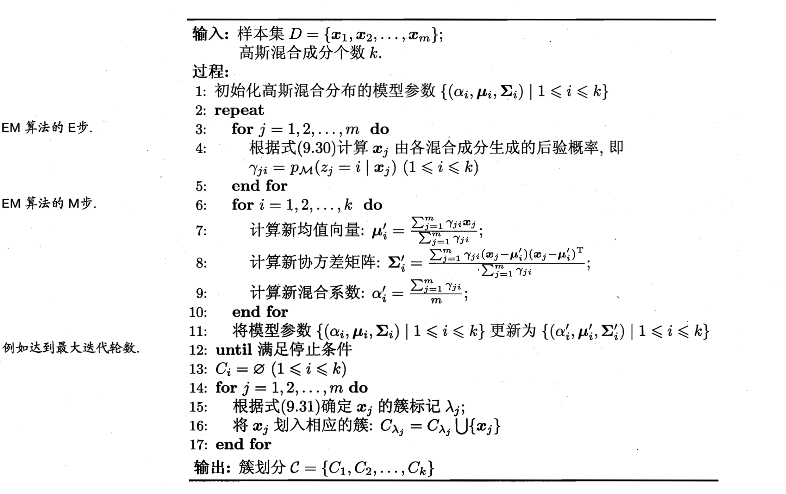
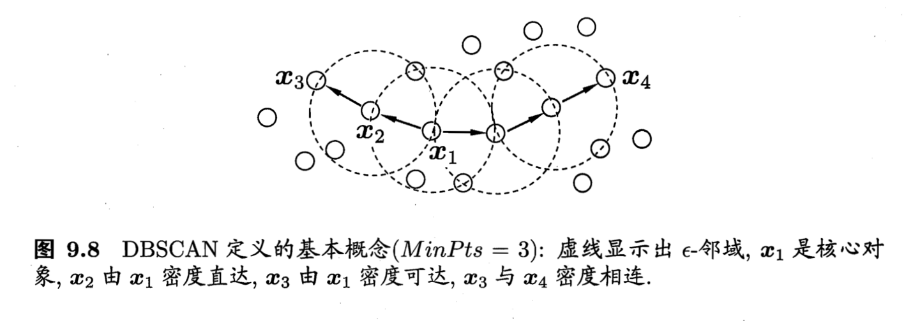
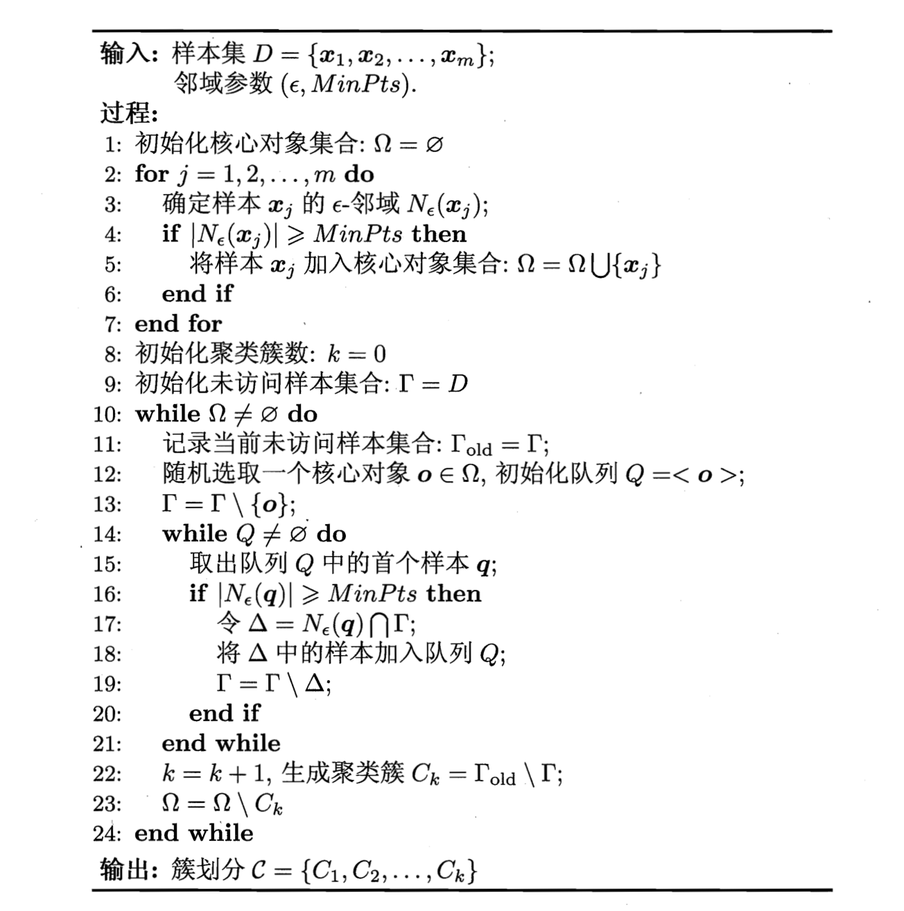
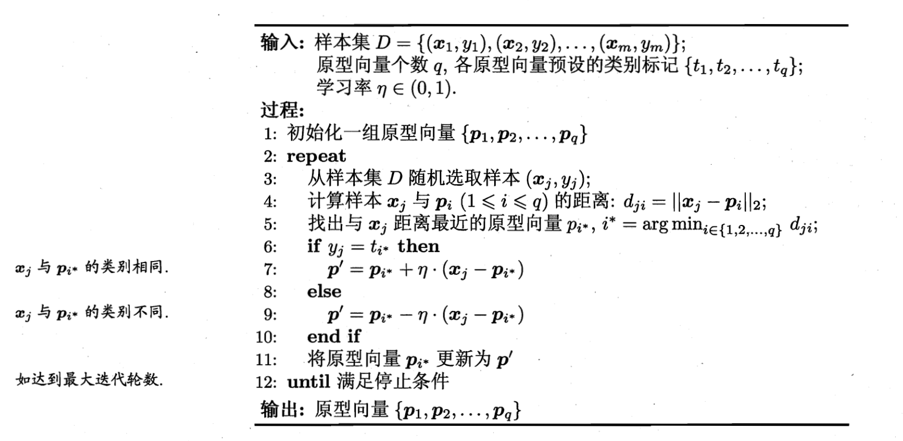
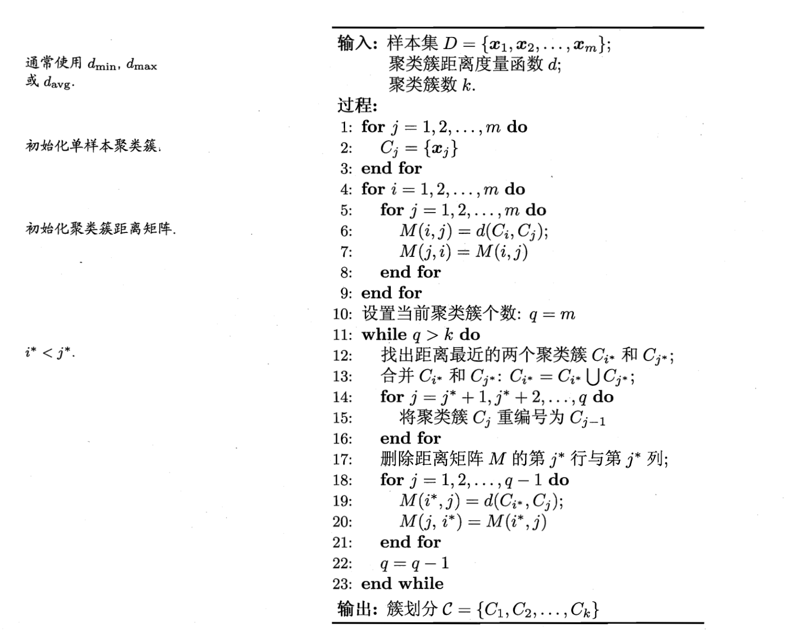

### 聚类算法总结

聚类是一种经典的无监督学习方法，无监督学习的目标是通过对无标记训练样本的学习，发掘和揭示数据集本身潜在的结构与规律，即不依赖于训练数据集的类标记信息。聚类则是试图将数据集的样本划分为若干个互不相交的类簇，从而每个簇对应一个潜在的类别。

聚类直观上来说是将相似的样本聚在一起，从而形成一个类簇（cluster）。那首先的问题是如何来度量相似性（similarity measure）呢？这便是距离度量，在生活中我们说差别小则相似，对应到多维样本，每个样本可以对应于高维空间中的一个数据点，若它们的距离相近，我们便可以称它们相似。那接着如何来评价聚类结果的好坏呢？这便是性能度量，性能度量为评价聚类结果的好坏提供了一系列有效性指标。

#### 1 Kmeans聚类

K-Means的思想十分简单，首先随机指定类中心，根据样本与类中心的远近划分类簇，接着重新计算类中心，迭代直至收敛：

假设输入空间 $\cal X \in \R^n \ $ 为$\ n\ $维向量的集合，$\ \cal{X}=\{x^{(1)} ,x^{(2)},\cdots,x^{(m)} \} \ $，$ \ \mathcal  C\ $为输入空间$\ \cal X\ $的一个划分，不妨令$\ \mathcal C=\{ \mathbb C_1,\mathbb C_2,\cdots,\mathbb C_K \} \ $，因此可以定义$\ k\text{-}means\ $算法的损失函数为
$$
J(\mathcal C)=\sum\limits_{k=1}^K\sum\limits_{x^{(i)}\in \mathbb C_k}\Vert x^{(i)}-\mu^{(k)} \Vert_2^2  \tag{1}
$$
其中$\ \mu^{(k)}=\frac{1}{\vert \mathbb C_k \vert}\sum\limits_{x^{(i)}\in\mathbb C_k}x^{(i)}  \ $是簇$\ \mathbb C_k\ $的聚类中心。

事实上，若将样本的类别看做为“隐变量”（latent variable），类中心看作样本的分布参数，这一过程正是通过EM算法的两步走策略而计算出，其根本的目的是为了最小化平方误差函数$J(\mathcal C)$

##### 1.1 算法流程

1. 首先随机初始化$\ K\ $个聚类中心，$\ \mu^{(1)},\mu^{(2)},\cdots,\mu^{(K)} \ $；

2. 然后根据这$\ K\ $个聚类中心给出输入空间$\ \mathcal X \ $的一个划分，$\ \mathbb C_1,\mathbb C_2,\cdots,\mathbb C_K \ $；

   - 样本离哪个簇的聚类中心最近，则该样本就划归到那个簇
     $$
     \mathop{\arg\min}_{k}\ \Vert x^{(i)}-\mu^{(k)} \Vert_2^2 \tag{2}
     $$

3. 再根据这个划分来更新这$\ K\ $个聚类中心
   $$
   \mu^{(k)}=\frac{1}{\vert \mathbb C_k \vert}\sum\limits_{x^{(i)}\in\mathbb C_k}x^{(i)} \tag{3}
   $$

4. 重复2、3步骤直至收敛

   - 即$\ K\ $个聚类中心不再变化

##### 1.2  算法实现

```scala
package com.strings.model.cluster

import breeze.linalg.{DenseMatrix, DenseVector, squaredDistance}
import com.strings.model.Model
import com.strings.data.Data

import scala.collection.mutable.ListBuffer
import scala.util.Random

class Kmeans(val k:Int = 3,
             val max_iter:Int = 100,
             val seed:Long = 1234L,
             val tolerance: Double = 1e-4) extends Model{

  private var centroids = List[DenseVector[Double]]()
  private var cluster = ListBuffer[(Int,DenseVector[Double])]()

  var iterations:Int = 0

  def _init_random_centroids(data : List[DenseVector[Double]]):List[DenseVector[Double]] = {
    val rng  = new Random(seed)
    rng.shuffle(data).take(k)
  }

  def _closest_centroid2(centroids:List[DenseVector[Double]],row:DenseVector[Double]):(Int,DenseVector[Double]) = {
        var close_i = 0
        var closest_dist = -1.0
        centroids.zipWithIndex.foreach(centroid => {
          val distance = squaredDistance(centroid._1,row)
          if(closest_dist>distance || closest_dist == -1.0){
            closest_dist = distance
            close_i = centroid._2
          }
        })
    (close_i,row)
  }

  def _closest_centroid(centroids:List[DenseVector[Double]],row:DenseVector[Double]):(Int,DenseVector[Double]) = {
      val distWithIndex =  centroids.zipWithIndex.map(x =>
                          (squaredDistance(x._1,row),x._2)
                          ).minBy(_._1)
      (distWithIndex._2,row)
  }

  def train(data:List[DenseVector[Double]]):Unit = {
    centroids = _init_random_centroids(data)
    var flag = true
    for(_ <- Range(0,max_iter) if flag){
      iterations += 1
      data.foreach{d =>
        val b = _closest_centroid(centroids, d)
        cluster.append(b)
      }
      val prev_centroid = centroids
      centroids = _calculate_centroids(cluster)
      cluster = ListBuffer[(Int,DenseVector[Double])]()
      val diff = prev_centroid.zip(centroids).map(x => squaredDistance(x._2,x._1))
      if( diff.sum < tolerance){
        flag = false
      }
    }

  }

  def predit(data:List[DenseVector[Double]]):List[(Int,DenseVector[Double])]= {
    data.map(x => _closest_centroid(centroids,x))
  }

  def _calculate_centroids(cluster:ListBuffer[(Int,DenseVector[Double])]):List[DenseVector[Double]]= {
    cluster.groupBy(_._1).map { x =>
      val temp = x._2.map(_._2)
      temp.reduce((a, b) => a :+ b).map(_ / temp.length)
    }.toList
  }

  /**
   * @param x input matrix
   * @return predict vector value
   */
  override def predict(x: DenseMatrix[Double]): DenseVector[Double] = {
    DenseVector[Double]()
  }
}

object Kmeans{
  def main(args: Array[String]): Unit = {
    val irisData = Data.irisData
    val data = irisData.map(_.slice(0,4)).map(DenseVector(_)).toList
    val kmeans = new Kmeans(max_iter = 100)
    kmeans.train(data)
    println(kmeans.centroids)

  }
}
```

详细请参考：https://github.com/StringsLi/ml_scratch_scala/blob/master/src/main/scala/com/strings/model/cluster/Kmeans.scala 

#### 2 GMM 聚类

GMM聚类又称高斯混合聚类，即采用高斯分布来描述原型。现假设每个类簇中的样本都服从一个多维高斯分布，那么空间中的样本可以看作由k个多维高斯分布混合而成。

##### 2.1 算法过程

高斯分布的定义，对于$n$维样本空间$\mathcal X$中的随机向量$x$，若$x$服从高斯分布，其概率密度函数为
$$
p(x) = \frac{1}{(2\pi)^{\frac{n}{2}}|\Sigma|^{\frac{1}{2}}}e^{-\frac{1}{2}(x-\mu)^T\Sigma^{-1}(x-\mu)}  \tag{4}
$$
其中$\mu$是$n$维均值向量，$\Sigma$是$n\times n$的协方差矩阵,由(4)可以看出，高斯分布完全由均值向量和协方差矩阵$\Sigma$这两个参数确定。为了明确高斯分布与相应的参数的依赖关系，将概率密度函数记为$p(x|\mu,\Sigma)$.

我们可以定义高斯混合分布
$$
p_{\mathcal M}(x) = \sum_{i=1}{k}\alpha_i.p(x|\mu_i,\Sigma_i) \tag{5}
$$
$α_i$称为混合系数,满足$\sum_{i=1}^{k}\alpha_i=1$，假设样本的生成过程由高斯混合分布给出：首先，根据$\alpha_1,\alpha_2,...,\alpha_k$定义的先验分布选择高斯混合成分，其中$α_i$为选择第$i$混合成分的概率，然后根据被选择的混合成分的概率密度函数进行采样，从而生成相应的样本。

若训练集$D={x_1,x_2,...,x_m}$由上述过程生成，令随机变量$z_j \in{1,2,...,k}$表示生成样本的高斯混合成分，根据贝叶斯定理，$z_j$的后验分布对应于
$$
p_{\mathcal M}(z_j = i | x_j) = \frac{P(z_j=i).p_{\mathcal M}(x_j|z_j=i)}{p_{\mathcal M}(x_j)} \\
=\frac{\alpha_i.p(x_j|\mu_i,\Sigma_i)}{\sum_{l=1}^{k}\alpha_l.p(x_j|\mu_l,\Sigma_l)}   \tag{6}
$$
当高斯混合分布(5)已知时，高斯混合聚类将样本集$D$划分为$k$个簇$\mathcal C = {C_1,C_2,...,C_k}$,将每个样本$x_j$的簇标记为$\lambda_j$如下确定：
$$
\lambda_j = \arg \max _{i\in{1,2...,k}}\gamma_{ji} \tag{7}
$$
对于(5)式，模型参数$\{(\alpha_i,\mu_i,\Sigma_i)|1\leq i \leq k\}$如何求解？显然给定样本集$D$，可以采用极大似然估计，即最大化对数似然：
$$
LL(D) = \ln(\prod_{j}^mp_{\mathcal M}(x_j)) \\
=\sum_{j=1}^{m}ln(\sum_{i=1}^{k}\alpha_i.p(x_j|\mu_i,\Sigma_i)) \tag{8}
$$
采用EM算法进行迭代优化求解，下面做个简单地推导：

若参数$\{(\alpha_i,\mu_i,\Sigma_i)|1\leq i \leq k\}$能使(8)式最大化，则由$\frac{\partial LL(D)}{\partial \mu_i} = 0$有：
$$
\sum_{j=1}^{m}\frac{\alpha_i.p(x_j|\mu_i,\Sigma_i)}{\sum_{l=1}^{k}\alpha_l.p(x_j|\mu_l,\Sigma_l)}(x_j - \mu_i) \tag{9}
$$
由(6)式以及$\gamma_{ji} = p_{\mathcal M}(z_j = i |x_j)$有
$$
\mu_i = \frac{\sum_{j=1}^{m}\gamma_{ji}x_j}{\sum_{j=1}^m\gamma_{ji}} \tag{10}
$$
即混合成分的均值可以通过样本的加权平均来估计，样本权重是每个样本属于该成分的后验概率，类似的，由$\frac{\partial LL(D)}{\partial \Sigma_i} = 0$可以得到：
$$
\Sigma_i = \frac{\sum_{j=1}^{m}\gamma_{ji}(x_j-\mu_i)(x_j-\mu_i)^T}{\sum_{j=1}^m\gamma_{ji}} \tag{11}
$$
对于混合系数，使用拉格朗日法可以得到：
$$
\alpha_i = \frac{1}{m}\sum_{j=1}^{m}\gamma_{ji} \tag{12}
$$
即每个高斯成分的混合系数由样本属于该成分的平均后验概率确定。

由上述推导可得高斯混合模型的EM算法：在每步迭代中，先根据当前参数来计算每个样本属于高斯成分的后验概率$\gamma_{ji}$(**E步**), 再根据式(10)-(12)更新参数模型$\{(\alpha_i,\mu_i,\Sigma_i)|1\leq i \leq k\}$（**M步**）.

##### 2.2  算法流程

GMM算法步骤如下：



##### 2.3 算法实现

```scala
package com.strings.model.cluster

import breeze.linalg.{*, Axis, DenseMatrix, DenseVector, argmax, det, max, norm, pinv, sum}
import com.strings.data.Data
import com.strings.model.metric.Metric
import com.strings.utils.MatrixUtils
import org.slf4j.LoggerFactory

import util.control.Breaks.breakable
import util.control.Breaks.break
import scala.collection.mutable.ArrayBuffer

class GMM(k:Int = 3,
          max_iterations:Int = 2000,
          tolerance:Double = 1e-8) {

  private val logger = LoggerFactory.getLogger(classOf[GMM])

  var means:Array[DenseVector[Double]] = new Array[DenseVector[Double]](k)
  var vars:Array[DenseMatrix[Double]] = new Array[DenseMatrix[Double]](k)
  var sample_assignments:DenseVector[Int] = _
  var priors:DenseVector[Double] = _
  var responsibility:DenseMatrix[Double] = _
  var responsibilities:ArrayBuffer[DenseVector[Double]] = new ArrayBuffer[DenseVector[Double]]()

  def _initialize(X:DenseMatrix[Double]): Unit ={
    val n_samples = X.rows
    val X_lst = (0 until n_samples).map(X.t(::,_))
    val rng =  new scala.util.Random()
    priors = DenseVector.ones[Double](k) :/ k.toDouble
    means = rng.shuffle(X_lst).take(k).toArray
//    means = X_lst.take(k).toArray
    for(i <- 0 until k){
      vars(i) = MatrixUtils.calculate_covariance_matrix(X)
    }
  }

  def multivariate_gaussian(X:DenseMatrix[Double],i:Int):DenseVector[Double]={
    val n_features = X.cols
    val mean = means(i)
    val covar = vars(i)
    val determinant = det(covar)
    val likelihoods = DenseVector.zeros[Double](X.rows)
    val X_arr = (0 until X.rows).map(X.t(::,_))

    for((sample,index) <- X_arr.zipWithIndex){
      val d = n_features
      val coeff = 1.0 / (math.pow(2 * Math.PI,d/2) * math.sqrt(determinant))
      val gram = (sample :- mean).t * pinv(covar) * (sample :- mean)
      val exponent = math.exp(-0.5 * gram)
      likelihoods(index) = coeff * exponent
    }
    likelihoods
  }

  def _get_likelihoods(X:DenseMatrix[Double]):DenseMatrix[Double] = {
    val n_samples = X.rows
    val likelihoods = DenseMatrix.zeros[Double](n_samples,k)
    for(i <- 0 until k){
      likelihoods(::,i) := multivariate_gaussian(X,i)
    }
    likelihoods
  }

  def _expectation(X:DenseMatrix[Double]): Unit ={
    val weighted_likelihoods = _get_likelihoods(X)(*,::).map(x => x :* priors)
    val sum_likelihoods = sum(weighted_likelihoods,Axis._1)
    responsibility = weighted_likelihoods(::,*).map(x => x :/ sum_likelihoods) // 列除
    sample_assignments = argmax(responsibility,Axis._1)
    responsibilities.append(max(responsibility,Axis._1))
  }

  def _maximization(X:DenseMatrix[Double]): Unit ={
    for(i <- 0 until k){
      val resp = responsibility(::,i)
      val mean = sum(X(::,*).map(f => resp :* f),Axis._0) :/ sum(resp)
      means(i) = mean.t
      val diff = X(*,::).map(f => f :- mean.t)
      val covariance = diff.t * diff(::,*).map(f => f :* resp) :/sum(resp) // 注意diff(::,*)是取列运算
      vars(i) = covariance
    }
    val n_samples = X.rows
    priors = sum(responsibility,Axis._0).t :/ n_samples.toDouble
  }

  def predict(X:DenseMatrix[Double]): DenseVector[Double] = {
    _initialize(X)
    var iter = 0
    var flag = true
    for (_ <- 0 until max_iterations if flag) {
      iter += 1
      _expectation(X)
      _maximization(X)
      breakable {
        if (responsibilities.length < 2) {
          break()
        }else{
          val n = responsibilities.length
          val diff = norm(responsibilities(n-1) - responsibilities(n-2), 2)
          println(diff)
          if (diff <= tolerance) flag = false
        }
    }
  }
    logger.info(s"$iter 之后收敛")
    _expectation(X)
    sample_assignments.map(_.toDouble)
  }

}

object GMM{
  def main(args: Array[String]): Unit = {

    val irisData = Data.irisData
    val data = irisData.map(_.slice(0,4)).toList
    val target = irisData.map(_.apply(4))

    val gmm = new GMM(max_iterations = 100)
    gmm._initialize(DenseMatrix(data:_*))

    val pred = gmm.predict(DenseMatrix(data:_*))
    println(pred)

  }
}
```

详细请参考:https://github.com/StringsLi/ml_scratch_scala/blob/master/src/main/scala/com/strings/model/cluster/GMM.scala

#### 3 DBSCAN聚类

密度聚类则是基于密度的聚类，它从样本分布的角度来考察样本之间的可连接性，并基于可连接性（密度可达）不断拓展疆域（类簇）。

DBSCAN是一种著名的密度聚类算法，它是一组“邻域”（neighbhood）参数($\epsilon $,MinPts)来刻画样本分布的紧密程度.给定数据集$D = \{x_1,x_2,...,x_m\}$,定义下面几个概念：

1. $\epsilon$-邻域：对于$x_j \in D$,其$\epsilon$-邻域包含样本集$D$中与$x_j$的距离不大于$\epsilon$的样本，即$N_{\epsilon}(x_j) = {x_i \in D | dist(x_i,x_j) \leq \epsilon}$;
2. 核心对象(core object):若$x_j$的$\epsilon$-邻域至少包含MinPts个样本，即$|N_{\epsilon}(x_j)| \geq MinPts$,则$x_j$是一个核心对象；
3. 密度直达(directly density-reachable):若$x_j$位于$x_i$的$\epsilon$-邻域中，且$x_i$是核心对象，则称$x_j$是由$x_i$密度直达；
4. 密度可达(density-reachable)：对$x_i$与$x_j$，若存在样本序列$p_1,p_2,...,p_n$,其中$p_1 = x_i,p_n = x_j$,且$p_{i+1}$由$p_i$密度直达，则称$x_j$由$x_i$密度可达；
5. 密度相连(density-connected):对$x_i$与$x_j$，若存在$x_k$使得$x_i$与$x_j$均由$x_k$密度可达，则称$x_i$与$x_j$密度相连；

下图给出了上述概念的直观显示：



##### 3.1 算法步骤

DBSCAN的算法的思想是找出一个核心对象所有密度可达的样本集合形成簇。首先从数据集中任选一个核心对象$A$，找出所有$A$密度可达的样本集合，将这些样本形成一个密度相连的类簇，直到所有的核心对象都遍历完。DBSCAN算法的流程如下图所示：



##### 3.2 算法实现

```scala
package com.strings.model.cluster

import breeze.linalg.{DenseMatrix, DenseVector, sum}
import com.strings.data.Data
import com.strings.model.metric.Metric
import util.control.Breaks.breakable
import util.control.Breaks.break
import scala.collection.mutable.ArrayBuffer

class DBSCAN(eps:Double = 1.0,
             min_samples:Int = 5) {

  var visited_samples:ArrayBuffer[Int] = new ArrayBuffer[Int]()
  var neighbors: Map[Int, Array[Int]] = Map()
  var X:DenseMatrix[Double] = _
  var clusters:ArrayBuffer[Array[Int]] = new ArrayBuffer[Array[Int]]()

  def euclidean_distance(x1:DenseVector[Double],x2:DenseVector[Double]): Double ={
    math.sqrt(sum((x1 :- x2) :* (x1 :- x2)))
  }

  def _get_neighbors(sample_i:Int): Array[Int] ={
    val neighbors:ArrayBuffer[Int] = new ArrayBuffer[Int]()
    val X_arr = (0 until X.rows).map(X.t(::,_))
    val X_arr2 =  X_arr.indices.filter(i => i != sample_i).map(X_arr(_))
    for((_sample,inx) <- X_arr2.zipWithIndex){
      val dist = euclidean_distance(_sample,X_arr(sample_i))
      if(dist < eps){
        neighbors.append(inx)
      }
    }
    neighbors.toArray
  }

  def _expand_cluster(sample_i:Int, neighbor:Array[Int]): Array[Int] ={
    val cluster:ArrayBuffer[Int] = new ArrayBuffer[Int]()
    cluster.append(sample_i)
    for(neighbor_i <- neighbor){
      if(!visited_samples.contains(neighbor_i)){
        visited_samples.append(neighbor_i)
        neighbors += (neighbor_i -> _get_neighbors(neighbor_i) )
        if (neighbors(neighbor_i).length >= min_samples){   //        neighbors.get(neighbor_i).size 结果是1
          val expanded_cluster = _expand_cluster(neighbor_i,neighbors(neighbor_i))
          cluster.append(expanded_cluster:_*)
        }else{
          cluster.append(neighbor_i)
        }
      }
    }
    cluster.toArray
  }

  def _get_cluster_labels(): Array[Int] ={
    val labels = Array.fill(X.rows)(clusters.length)
    for((cluster,cluster_i) <- clusters.zipWithIndex){
      for(sample_i <- cluster){
        labels(sample_i) = cluster_i
      }
    }
    labels
  }

  def predict(XX:DenseMatrix[Double]): Array[Int] ={
    X = XX
    visited_samples = new ArrayBuffer[Int]()
    neighbors = Map()
    val n_samples = X.rows
    for(sample_i <- 0 until n_samples){
      breakable {
        if (visited_samples.contains(sample_i)) {
          break()
        }else{
          neighbors += (sample_i -> _get_neighbors(sample_i))
          if(neighbors.get(sample_i).size >= min_samples){
            visited_samples.append(sample_i)
          }
          val new_cluster = _expand_cluster(sample_i,neighbors(sample_i))
          clusters.append(new_cluster)
        }
      }
    }
    _get_cluster_labels()
  }

}

object DBSCAN{
  def main(args: Array[String]): Unit = {

    val irisData = Data.irisData
    val data = irisData.map(_.slice(0,4)).toList
    val target = irisData.map(_.apply(4))

    val dbscan = new DBSCAN(eps = .7,min_samples = 5)

    val pred = dbscan.predict(DenseMatrix(data:_*))
    println(pred.toList)
  }
}
```

详细请参考：https://github.com/StringsLi/ml_scratch_scala/blob/master/src/main/scala/com/strings/model/cluster/DBSCAN.scala

#### 4 PAM聚类算法

K-means是每次选**簇的**均值**作为新的中心，迭代直到簇中对象分布不再变化。其缺点是对于离群点是敏感的，因为一个具有很大极端值的对象会扭曲数据分布。那么我们可以考虑新的簇中心不选择均值而是选择**簇内的某个对象**，只要使总的代价降低就可以。

PAM（partitioning around medoid，围绕中心点的划分）是具有代表性的k-medoids算法。

它最初随机选择k个对象作为中心点，该算法反复的用非代表对象（非中心点）代替代表对象，试图找出更好的中心点，以改进聚类的质量。 K均值聚类一般使用欧几里得距离，而PAM可以使用任意的距离来计算。因此， PAM可以容纳混合数据类型，并且不仅限于连续变量。

##### 4.1  算法步骤

​       PAM算法如下：
​       (1) 随机选择K个观测值（每个都称为中心点）；
​       (2) 计算观测值到各个中心的距离/相异性；
​       (3) 把每个观测值分配到最近的中心点；
​       (4) 计算每个中心点到每个观测值的距离的总和（总成本）；
​       (5) 选择一个该类中不是中心的点，并和中心点互换；
​       (6) 重新把每个点分配到距它最近的中心点；
​       (7) 再次计算总成本；
​       (8) 如果总成本比步骤(4)计算的总成本少，把新的点作为中心点；
​       (9) 重复步骤(5)～(8)直到中心点不再改变。

##### 4.2 算法实现

```scala
package com.strings.model.cluster

import breeze.linalg.{DenseMatrix, DenseVector, squaredDistance}
import com.strings.data.Data
import com.strings.model.metric.Metric

import scala.collection.mutable.ArrayBuffer
import scala.util.Random
import util.control.Breaks.breakable
import util.control.Breaks.break

/**
 *  Partitioning (clustering) of the data into k clusters “around medoids”, a more robust version of K-means.
 *
 * @param k nums of cluster
 */


class PAM(k:Int = 2,seed:Long = 1234L) {

  def _init_random_medoids(X: DenseMatrix[Double]): IndexedSeq[DenseVector[Double]] ={
    val n_samples = X.rows
    val data = (0 until n_samples).map(X.t(::,_))
    val rng  = new Random(seed)
    rng.shuffle(data).take(k)
  }

  def _closet_medoid(sample:DenseVector[Double],medoids:IndexedSeq[DenseVector[Double]]): Int ={
    val distWithIndex =  medoids.zipWithIndex.map(x =>
      (squaredDistance(x._1,sample),x._2)
    ).minBy(_._1)
    distWithIndex._2
  }

  def _create_clusters(X:DenseMatrix[Double],medoids:IndexedSeq[DenseVector[Double]]): Array[Array[Int]] ={
    val clusterss = new Array[Int](X.rows)
    val data = (0 until X.rows).map(X.t(::,_))
    for((sample,inx) <- data.zipWithIndex){
      val medoid_i = _closet_medoid(sample,medoids)
      clusterss(inx) = medoid_i
    }
    clusterss.zipWithIndex.groupBy(_._1).toArray.sortBy(_._1).map(_._2.map(_._2))
  }

  def _calculate_cost(X:DenseMatrix[Double],clusters:Array[Array[Int]],medoids:IndexedSeq[DenseVector[Double]]):Double={
    var cost = 0.0
    val data = (0 until X.rows).map(X.t(::,_))
    for((cluster,i) <- clusters.zipWithIndex){
      val medoid = medoids(i)
      for(sample_i <- cluster){
        cost += squaredDistance(data(sample_i),medoid)
      }
    }
    cost
  }

  def _get_cluster_labels(clusters:Array[Array[Int]],X:DenseMatrix[Double]): Array[Int] ={
    val y_pred = Array.fill(X.rows)(0)
    for(cluster_i <- 0 until clusters.length){
      val cluster = clusters(cluster_i)
      for(sample_i <- cluster){
        y_pred(sample_i) = cluster_i
      }
    }
    y_pred
  }
  def _get_no_medoids(X:DenseMatrix[Double],medoids:IndexedSeq[DenseVector[Double]]): Array[DenseVector[Double]] ={
    val non_medoids:ArrayBuffer[DenseVector[Double]] = new ArrayBuffer[DenseVector[Double]]()
    val data = (0 until X.rows).map(X.t(::,_))

    for(sample <- data){
      if(!medoids.contains(sample)) non_medoids.append(sample)
    }
    non_medoids.toArray
  }

  def predict(X:DenseMatrix[Double]): Array[Int] ={
    var medoids = _init_random_medoids(X)
    val clusters = _create_clusters(X,medoids)
    var cost = _calculate_cost(X, clusters, medoids)
    breakable {
      while (true) {
        var best_medoids = medoids
        var lowest_cost = cost
        for (medoid <- medoids) {
          val non_medoids = _get_no_medoids(X, medoids)
          for (sample <- non_medoids) {
            val new_medoids = new Array[DenseVector[Double]](medoids.length)
            for (i <- 0 until medoids.length) {
              new_medoids(i) = medoids(i)
            }
            val inx: IndexedSeq[Int] = medoids.indices.filter(i => medoids(i) == medoid)
            inx.foreach(i => new_medoids(i) = sample)

            val new_clusters = _create_clusters(X, new_medoids)
            val new_cost = _calculate_cost(X, new_clusters, new_medoids)

            if (new_cost < lowest_cost) {
              lowest_cost = new_cost
              best_medoids = new_medoids
            }
          }
        }
        if (lowest_cost < cost) {
          cost = lowest_cost
          medoids = best_medoids
        } else {
          break()
        }
      }
    }
    val finaly_clusters = _create_clusters(X,medoids)
    _get_cluster_labels(finaly_clusters,X)
  }

}

object PAM{
  def main(args: Array[String]): Unit = {
    val irisData = Data.irisData
    val data = irisData.map(_.slice(0,4)).toList
    val target = irisData.map(_.apply(4))

    val pam = new PAM(k = 3)

    val pred = pam.predict(DenseMatrix(data:_*))
    println(pred.toList)
    val acc =  Metric.accuracy(pred.map(_.toDouble),target) * 100
    println(f"准确率为: $acc%-5.2f%%")
  }
}

```

详细请参考：https://github.com/StringsLi/ml_scratch_scala/blob/master/src/main/scala/com/strings/model/cluster/PAM.scala

#### 5. LVQ聚类

LVQ又称“学习向量量化”(Learning Vector Quantization)也是试图找到一组原型向量来刻画聚类结构，但与一般聚类算法不同的是，LVQ假设样本带有类别标记，学习过程利用样本的这些监督信息来辅助聚类。

给定样本集$\{(x_1,y_1),(x_2,y_2),...,(x_m,y_m)\}$,每个样本$x_j$是由$n$个属性描述的特征向量$(x_{j1};x_{j2};...;x_{jn})$,$y_j \in \mathcal Y$是样本$x_j$的类别标记. LVQ的目标是学得一组$n$维原型向量$\{p_1,p_2,...,p_q\}$,每个原型向量代表一个聚类簇，簇标记为$t_i \in \mathcal Y$.

##### 5.1 算法步骤

LVQ的算法步骤如下：



##### 5.2 算法实现

```scala
package com.strings.model.cluster

import breeze.linalg.{DenseMatrix, DenseVector, argmin, sum}

import scala.collection.mutable.ArrayBuffer
import scala.util.Random

class LVQ(t:Array[Int],
          lr:Double = 0.1,
          nums_iters:Int = 400) {

  val c = t.distinct.length
  val q = t.length
  var C: Map[Int, ArrayBuffer[Int]] = Map()
  var p: DenseMatrix[Double] = _
  var labels: DenseVector[Int] = _

  def euclidean_distance(x1: DenseVector[Double], x2: DenseVector[Double]): Double = {
    require(x1.length == x2.length)
    math.sqrt(sum((x1 :- x2) :* (x1 :- x2)))
  }

  def fit(X: DenseMatrix[Double], y: DenseVector[Int]) = {
    p = DenseMatrix.zeros[Double](q, X.cols)
    for (i <- 0 until q) {
      C += (i -> ArrayBuffer[Int]())
      val candidate_indices = y.toArray.indices.filter(f => y(f) == t(i))
      val target_indice = Random.shuffle(candidate_indices.toList).take(1).apply(0)
      p(i, ::) := X(target_indice, ::)
    }


    var p_arr = (0 until p.rows).map(p.t(::, _))
    for (_ <- 0 until nums_iters) {
      val j = Random.shuffle(Range(0, y.length).toList).take(1).apply(0)
      val x_j = X(j, ::).t
      val d = p_arr.map(f => euclidean_distance(f, x_j))
      val idx: Int = argmin(d.toArray)
      if (y(j) == t(idx)) {
        p(idx, ::) := p(idx, ::) :+ ((X(j, ::) :- p(idx, ::)) :* lr)  // :+ 和 :* 运算优先级一致
      } else {
        p(idx, ::) := p(idx, ::) :- ((X(j, ::) :- p(idx, ::)) :* lr)
      }

    }
    p_arr = (0 until p.rows).map(p.t(::, _))
    for (j <- 0 until X.rows) {
      val d = p_arr.map(f => euclidean_distance(f, X(j, ::).t))
      val idx: Int = argmin(DenseVector(d.toArray))
      C(idx).append(j)
    }

    labels = DenseVector.zeros[Int](X.rows)
    for (i <- 0 until q) {
      for (j <- C(i)) {
        labels(j) = i
      }
    }
  }

  def predict(X: DenseMatrix[Double]): DenseVector[Int] = {
    val p_arr = (0 until p.rows).map(p.t(::, _))
    val preds_y: ArrayBuffer[Int] = new ArrayBuffer[Int]()
    for (j <- 0 until X.rows) {
      val d = p_arr.map(f => euclidean_distance(f, X(j, ::).t))
      val idx: Int = argmin(DenseVector(d.toArray))
      preds_y.append(t(idx))
    }
    DenseVector(preds_y.toArray)
  }
}

object LVQ{
  def main(args: Array[String]): Unit = {

    val X = Array(Array(0.697,0.460),Array(0.774,0.376),Array(0.634,0.264),Array(0.608,0.318),Array(0.556,0.215),
                  Array(0.403,0.237),Array(0.481,0.149),Array(0.437,0.211),Array(0.666,0.091),Array(0.243,0.267),
                  Array(0.245,0.057),Array(0.343,0.099),Array(0.639,0.161),Array(0.657,0.198),Array(0.360,0.370),
                  Array(0.593,0.042),Array(0.719,0.103),Array(0.359,0.188),Array(0.339,0.241),Array(0.282,0.257),
                  Array(0.748,0.232),Array(0.714,0.346),Array(0.483,0.312),Array(0.478,0.437),Array(0.525,0.369),
                  Array(0.751,0.489),Array(0.532,0.472),Array(0.473,0.376),Array(0.725,0.445),Array(0.446,0.459))

   val XX = DenseMatrix(X:_*)
   val y = DenseVector.zeros[Int](XX.rows)

    for(i <- 9 until 21){
      y(i) = 1
    }

    val t = Array(0,1,1,0,0)
    println(y)
    val lvq = new LVQ(t)
    lvq.fit(XX,y)

    println(lvq.C)
    println(lvq.labels)
    println(lvq.predict(XX))

  }
}
```

详细代码请参考：

https://github.com/StringsLi/ml_scratch_scala/blob/master/src/main/scala/com/strings/model/cluster/LVQ.scala

代码实现参考了python代码：

https://github.com/fengyang95/tiny_ml/blob/master/tinyml/cluster/LVQ.py

#### 6 层次聚类

层次聚类(hierarchical clustering)是一种基于树形结构的聚类方法，常用的是**自底向上**的结合策略（**AGNES算法**），它将数据集中的每个样本看作一个初始聚类簇，然后再算法运行的每一步中找到距离最近的两个聚类簇进行合并，该过程不断重复，直至达到预设的聚类簇个数。这里的关键是如何计算聚类簇之间的距离。实际上，每个簇是一个样本集合，只需要采用集合的某种距离即可。例如，给定聚类簇$C_i$与$C_j$,可以通过下面的式子来计算距离：

最小距离：
$$
d_{\min}(C_i,C_j) = \min _{x \in C_i,z \in C_j}dist(x,z)  \tag{15}
$$
最大距离：
$$
d_{\max}(C_i,C_j) = \max_{x \in C_i,z \in C_j}dist(x,z)  \tag{16}
$$
平均距离：
$$
d_{avg}(C_i,C_j) = \frac{1}{|C_i||C_j|}dist(x,z)  \tag{17}
$$
显然，最小距离由两个簇的最近的样本决定；最大距离由两个簇的最远样本决定，而平均距离则由两个簇的所有样本决定。

##### 6.1  算法步骤

AGNES 算法步骤如下,在1-9行，算法先对仅含一个样本的初始聚类簇和相应的距离进行初始化，然后在11-23行，AGNES不断合并距离最近的聚类簇，并对合并得到的聚类簇的距离矩阵进行更新；上述过程不断重复，直至达到预设的聚类簇数。



##### 6.2 算法实现

```scala
package com.strings.model.cluster

import breeze.linalg.{DenseMatrix, DenseVector}
import com.strings.data.Data
import com.strings.utils.MatrixUtils

import scala.collection.mutable.ArrayBuffer


case class ClusterNode(vector:DenseVector[Double],
                       id:Int,
                       left:ClusterNode = null,
                       right:ClusterNode = null,
                       distance:Double = -1.0,
                       count:Int = 1)

class HierarchicalCluster(k:Int) {

  var labels:DenseVector[Int] = _

  def fit(X:DenseMatrix[Double]): Unit ={
    val n_samples = X.rows
    val n_features = X.cols
    val X_arr = (0 until n_samples).map(X.t(::,_))
    val nodes:ArrayBuffer[ClusterNode] = new ArrayBuffer[ClusterNode]()
    for((sample,inx) <- X_arr.zipWithIndex){
      nodes.append(ClusterNode(sample,inx))
    }
    labels = DenseVector.ones[Int](n_samples) :* (-1)
    var distances: Map[(Int, Int), Double] = Map()
    var curret_cluster_id = -1
    while (nodes.length > k){
      var min_dist = Double.MaxValue
      val nodes_len = nodes.length
      var closest_part:(Int, Int) = 0 -> 0
      for(i <- 0 until nodes_len - 1){
        for(j <- i+1 until nodes_len){
          val d_key = nodes(i).id -> nodes(j).id
          if(!distances.contains(d_key)){
            distances += (d_key -> MatrixUtils.euclidean_distance(nodes(i).vector,nodes(j).vector))
          }
          val d = distances(d_key)
          if(d < min_dist){
            min_dist = d
            closest_part = i -> j
          }
        }
      }

      val part1 = closest_part._1
      val part2 = closest_part._2
      val node1 = nodes(part1)
      val node2 = nodes(part2)
      val new_vec = DenseVector.ones[Double](n_features)
      for(i <- 0 until n_features){
        new_vec(i) = (node1.vector(i) * node1.count + node2.vector(i) * node2.count)/
          (node1.count + node2.count)
      }
      val new_count = node1.count + node2.count
      val new_node = ClusterNode(new_vec,curret_cluster_id,node1,node2, min_dist,new_count)

      curret_cluster_id -= 1
      nodes.remove(part2)
      nodes.remove(part1)
      nodes.append(new_node)
    }
    calc_label(nodes)

  }

  def calc_label(nodes:ArrayBuffer[ClusterNode]): Unit ={
    for((node,inx) <- nodes.zipWithIndex){
      leaf_traveral(node,inx)
    }
  }

  def leaf_traveral(node:ClusterNode,label:Int): Unit ={
    if(node.left == null && node.right == null){
      labels(node.id) = label
    }
    if(node.left != null){
      leaf_traveral(node.left,label)
    }
    if(node.right != null){
      leaf_traveral(node.right,label)
    }
  }
}

object HierarchicalCluster{
  def main(args: Array[String]): Unit = {
    val irisData = Data.irisData
    val data = irisData.map(_.slice(0,4))
    val dd = DenseMatrix(data:_*)
    val hc = new HierarchicalCluster(k=3)
    hc.fit(dd)
    println(hc.labels)
  }
}

```

算法实现参考了：

https://zhuanlan.zhihu.com/p/32438294

#### 7 MeanShift 均值漂移聚类算法

​        Mean Shift（均值漂移）是基于密度的非参数聚类算法，其算法思想是假设不同簇类的数据集符合不同的概率密度分布，找到任一样本点密度增大的最快方向，样本密度高的区域对应于该分布的最大值，这些样本点最终会在局部密度最大值收敛，且收敛到相同局部最大值的点被认为是同一簇类的成员。

##### 7.1 算法流程

1. 计算 每个样本的均值漂移矩阵$m_h(x)$，即
   $$
   m_h(x) = \frac{\sum_{i=1}^{n}{G(\frac{x_i - x}{h})}w(x_i)x_i}{\sum_{i=1}^{n}{G(\frac{x_i - x}{h})}w(x_i)}
   $$

2. 把$m_h(x)$ 赋给x；
3. 如果 $||m_h(x) - x|| < \epsilon $,结束循环，否则执行步骤1；

##### 7.2  代码

```scala
package com.strings.model.cluster
import util.control.Breaks._
import breeze.linalg.{Axis, DenseMatrix, DenseVector, sum, tile}
import breeze.numerics.{exp, pow, sqrt}
import com.strings.data.Data
import scala.collection.mutable.ArrayBuffer

class MeanShift(val kernel_bandwidth:Double) {

  def euclidean_distance(x1:DenseVector[Double],x2:DenseVector[Double]): Double ={
    math.sqrt(sum((x1 :- x2) :* (x1 :- x2)))
  }

  def gaussian_kernel(distance:DenseMatrix[Double],kernel_bandwidth:Double):DenseVector[Double] ={
    val euclidean_distance = sqrt(sum(pow(distance,2),Axis._1))
    val coefficient = 1.0 / (kernel_bandwidth*math.sqrt(2* math.Pi))
    coefficient * exp(pow(euclidean_distance / kernel_bandwidth,2) * (-0.5))
  }


  def shiftPoint(point:DenseVector[Double],points:List[DenseVector[Double]],kernel_bandwidth:Double):DenseVector[Double] ={
    val distance = points.map(t => point - t)
    val point_weights = gaussian_kernel(DenseMatrix(distance:_*),kernel_bandwidth)
    val tiled_weight = tile(point_weights,1,point.length)
    val denominator = sum(point_weights)
    sum(tiled_weight :* DenseMatrix(points:_*),Axis._0).t / denominator //各个元素对应相乘
  }

  def group_points(points:List[DenseVector[Double]]):List[Int] = {
    val cluster_ids:ArrayBuffer[Int] = new ArrayBuffer[Int]()
    var cluster_idx = 0
    val cluster_centers:ArrayBuffer[DenseVector[Double]] = new ArrayBuffer[DenseVector[Double]]()

    for((point,i) <- points.zipWithIndex){
      if(cluster_ids.length == 0){
        cluster_ids.append(cluster_idx)
        cluster_centers.append(point)
        cluster_idx += 1
      }else{
        for((center,j) <- cluster_centers.zipWithIndex){
          val dist = euclidean_distance(point, center)
          if(dist < 0.1){
            cluster_ids.append(j)
          }
        }

        if(cluster_ids.length < i + 1) {
          cluster_ids.append(cluster_idx)
          cluster_centers.append(point)
          cluster_idx += 1
        }
      }
    }
    cluster_ids.toList
  }

  def fit(points:List[DenseVector[Double]]):List[Int]={
    val shift_points = points
    var max_min_dist = 1.0
    var iteration_number = 0
    val still_shifting:Array[Boolean] = Array.fill(points.length)(true)
    val MIN_DISTANCE = 1e-5
    while (max_min_dist > MIN_DISTANCE) {
      max_min_dist = 0.0
      iteration_number += 1

      for (i <- 0 until shift_points.length) {
        breakable {
          if (!still_shifting(i)) {
            break
          }
        }
        var p_new = shift_points(i).copy
        val p_new_start = p_new.copy
        p_new = shiftPoint(p_new, points, kernel_bandwidth)
        val dist = euclidean_distance(p_new, p_new_start)
        if(dist > max_min_dist){
          max_min_dist = dist
        }
        if(dist < MIN_DISTANCE){
          still_shifting(i) = false
        }
        shift_points(i) := p_new
      }
    }
    group_points(shift_points)
  }

}

object MeanShift{

  def main(args: Array[String]): Unit = {
    val irisData = Data.irisData
    val data = irisData.map(_.slice(0,4)).map(DenseVector(_)).toList
    val ms = new MeanShift(kernel_bandwidth = 0.3)
    val label = ms.fit(data)
    println(label)
  }

}
```

代码详细地址请参考：

https://github.com/StringsLi/ml_scratch_scala/blob/master/src/main/scala/com/strings/model/cluster/MeanShift.scala

#### 参考文献

1. 周志华 机器学习 - 聚类部分

p.s. 该总结主要介绍每个聚类算法的算法步骤，以及scala的简单实现，并没有多注重效率，仅供自己学习使用。