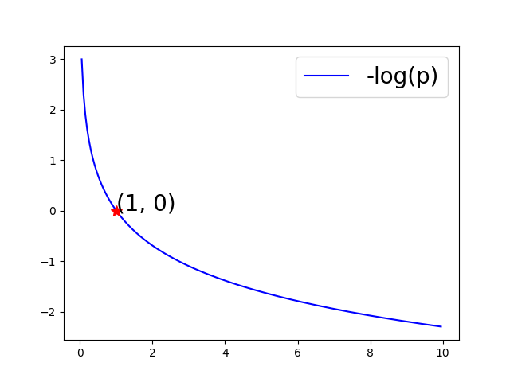
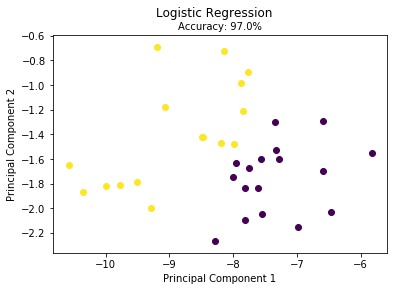
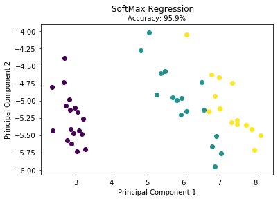

### 逻辑回归分类和softmax分类

### 1.逻辑回归

#### 1.1 算法原理

一些回归算法也可以用于分类，反之亦然。逻辑回归就是被广泛用于估算一个实例属于某个特定类别的概率。如果估算概率超过50%就是属于该类，反之则不是。

#### 1.2 假设函数

​	回顾线性回归中的假设函数$h_\theta(x)=\theta_0+\theta_1x_1+\cdots+\theta_nx_n=\theta^Tx$这表示的是一个超平面，逻辑回归中的超平面与线性回归中的超平面并无什么本质上的差异，但是线性回归是回归问题逻辑回归是分类问题两者本质上不同，线性回归中样本集中在超平面附近且没有类别差异而逻辑回归中样本点被所超平面分割且有明确的类别。因此逻辑回归的假设函数需要判断样本点在超平面上还是超平面下，所以给出一种映射关系：
$$
g(z) = \dfrac{1}{1+e^{-z}}
$$
函数$\ g(z)\ $称为$sigmoid$函数，其函数图像如下图所示：


使用$sigmoid$函数对超平面进行映射是因为它有一些很好的性质：

- $sigmoid$函数把所有样本点都映射到(0,1)区间内

- $sigmoid$函数连续可导，求导后的形式很$nice$
  $$
  \begin{aligned}
  g'(z) &=\dfrac{\mathrm{d}}{\mathrm{d}z} \dfrac{1}{1+e^{-z}}\\
  &=\dfrac{1}{(1+e^{-z})^2}(e^{-z})\\
  &=\dfrac{1}{1+e^{-z}} \cdot \left(1-  \dfrac{1}{1+e^{-z}} \right)\\
  &=g(z)\cdot(1-g(z))
  \end{aligned}
  $$


综上可以给出逻辑回归算法的假设函数$\ h_\theta(x)\ $
$$
h_\theta(x)=g(\theta^Tx)=\dfrac{1}{1+e^{-\theta^Tx}}
$$

#### 1.3 构造逻辑回归算法的损失函数

​	不妨假设含有$m$个样本数据($x^{(1)}$,$y^{(1)}$)、($x^{(2)}$,$y^{(2)}$)、$\cdots$、($x^{(m)}$,$y^{(m)}$)，$y^{(i)} \in \{0,1\}$。由于$h_\theta(x) \in (0,1)$，且对于某个样本数据来说它只能属于两种类别中的某一类，所以有如下等式成立
$$
\begin{aligned}
P(y=1|x;\theta)&=h_\theta(x)\\
P(y=0|x;\theta)&=1-h_\theta(x)
\end{aligned}
$$

训练梯度下降算法的完整迭代更新格式为
$$
\theta_j:=\theta_j-\alpha \sum\limits_{i=1}^m(h_\theta(x^{(i)})-y^{(i)})x_j^{(i)} \ \ \ ( j\ \  for \ \ 0 \ \sim \ n)
$$
**可以发现逻辑回归模型的迭代更新格式和线性回归模型的迭代更新格式完全一样，但是它们的假设函数$\ h_\theta(x)\ $的函数表达式是不一样的**。

#### 1.5 梯度下降过程的向量化

​	向量化是使用矩阵计算来代替$for$循环 ，以简化计算过程提高效率 ，上述迭代更新的过程中有一个连加符号，如果使用$for$循环则需要执行$m$次。在此之前需要先定义一些矩阵，不妨令：
$$
\begin{aligned}
Y&=
\begin{bmatrix}
(y^{(1)}) \\ (y^{(2)}) \\ \vdots \\ (y^{(m)})
\end{bmatrix}\ \ \ \ \ \ \ \ \ \ \ \ \ \ \ \
\theta=
\begin{bmatrix}
\theta_0 \\ \theta_1 \\ \vdots \\ \theta_n
\end{bmatrix}\\
~\\
X&=
\begin{bmatrix}
(x^{(1)})^T \\ (x^{(2)})^T \\ \vdots \\ (x^{(m)})^T
\end{bmatrix}
=
\begin{bmatrix}
1 & x_1^{(1)} & x_2^{(1)} & \cdots & x_n^{(1)} \\
1 & x_1^{(2)} & x_2^{(2)} & \cdots & x_n^{(2)} \\
\vdots & \vdots & \vdots & \cdots & \vdots \\
1 & x_1^{(m)} & x_2^{(m)} & \cdots & x_n^{(m)}
\end{bmatrix}\\
\end{aligned}
$$
则
$$
\begin{aligned} \phi&=g(X\theta)= \begin{bmatrix} h_\theta(x^{(1)}) \\ h_\theta(x^{(2)}) \\ \vdots \\ h_\theta(x^{(m)}) \end{bmatrix} =g\left(\begin{bmatrix} \theta_0+\theta_1x_1^{(1)}+\cdots + \theta_nx_n^{(1)} \\ \theta_0+\theta_1x_1^{(2)}+\cdots + \theta_nx_n^{(2)}\\ \vdots \\ \theta_0+\theta_1x_1^{(m)}+\cdots + \theta_nx_n^{(m)} \end{bmatrix}\right)\\ ~\\ E&=h_\theta(x)-y=\phi-Y= \begin{bmatrix} \varepsilon_1 \\ \varepsilon_2 \\ \vdots \\ \varepsilon_m \end{bmatrix}\\ \end{aligned}\\
$$
所以
$$
\sum\limits_{i=1}^m(h_\theta(x^{(i)})-y^{(i)})x_j^{(i)} = X\Epsilon
$$
最后
$$
\theta_j:=\theta_j-\alpha \sum\limits_{i=1}^m(h_\theta(x^{(i)})-y^{(i)})x_j^{(i)} \ \ \ ( j\ \  for \ \ 0 \ \sim \ n)
$$
向量化后可改为
$$
\theta:=\theta-\alpha X\Epsilon \ \ \ \ \ \\
$$

#### 1.6 总结

​	逻辑回归算法是机器学习算法中比较好理解的分类模型，训练速度也很快。因为只需要存储各个维度的特征值的原因，对资源尤其是内存的占用会比较小 ，在引入了$softmax$以后可以处理多分类的问题。 任何机器学习模型都是有自己的假设，在这个假设成立的情况下模型才是适用的。逻辑回归的第一个基本假设是**假设样本数据的先验分布为伯努利分布。** 

总结一下：逻辑回归模型概率估算:
$$
\hat{p}=h_\theta(x)=\sigma(\theta^T\cdot x)
$$
逻辑函数：
$$
\sigma(t)=\frac{1}{1+exp(-t)}
$$
单个训练实例的损失函数:
$$
c(\theta)=
\begin{cases}
-log(h_{\theta (x)}) & (y=1)\\
-log(1-\theta (x)) & (y=0)
\end{cases}
$$
$-log p$ 的图像所下：



我们可以看到，当$p$接近于$0$的时候，$-\log(p)$会变得非常大，所以如果模型估算一个正实例的概率接近于$0$，那么损失函数就会非常高，反过来，当$p$接近于$1$的时候，$-\log(p)$接近于$0$，所以对一个负类实例估算出的概率接近于$0$，损失函数也会很低。


#### 1.7 scala 代码实现

```scala
package ml.scrath.classification

import scala.collection.mutable.ArrayBuffer
import breeze.linalg.{DenseMatrix => BDM, DenseVector => BDV}


object LogitRegression{
  def main(args: Array[String]): Unit = {
    val dataS = scala.io.Source.fromFile("D:/data/iris.csv").getLines().toSeq.tail
      .map{_.split(",").filter(_.length() > 0).map(_.toDouble)}
      .toArray
    val data = BDM(dataS:_*)

    val features = data(0 to 98, 0 to 3)
    val labels = data(0 to 98, 4)

    val model = new LogitRegression
    val w = model.fit(features,labels)
    val predictions = model.predict(w, features)
    val predictionsNlabels = predictions.toArray.zip(labels.toArray)
    val rate = predictionsNlabels.filter(f => f._1==f._2).length.toDouble/predictionsNlabels.length.toDouble
    println("正确率为：" + rate)
  }
}


class LogitRegression (var lr: Double = 0.01, var tolerance: Double = 1e-6, var num_iters: Int = 1000) {

  def fit(x: BDM[Double], y_train: BDV[Double]): BDV[Double] = {
    val ones = BDM.ones[Double](x.rows, 1)
    val x_train = BDM.horzcat(ones, x)
    val n_samples = x_train.rows
    val n_features = x_train.cols
    var weights = BDV.ones[Double](n_features) :* .01 // 注意是:*

    val loss_lst: ArrayBuffer[Double] = new ArrayBuffer[Double]()
    loss_lst.append(0.0)

    var flag = true
    for (i <- 0 to num_iters if flag) {
      val raw_output = (x_train * weights).map(sigmoid(_))
      val error = raw_output - y_train
      val loss: Double = error.t * error
      val delta_loss = loss - loss_lst.apply(loss_lst.size - 1)
      loss_lst.append(loss)
      if (scala.math.abs(delta_loss) < tolerance) {
        flag = false
      } else {
        val gradient = (error.t * x_train) :/ n_samples.toDouble
        weights = weights - (gradient :* lr).t
      }
    }
    weights
  }

  def sigmoid(inX: Double) = {
    1.0 / (1 + scala.math.exp(-inX))
  }

  def predict(weights: BDV[Double], x: BDM[Double]): BDV[Double] = {
    val x_test = BDM.horzcat(BDM.ones[Double](x.rows, 1), x)
    val output = (x_test * weights).map(sigmoid(_)).map(x => if(x > 0.5) 1.0 else 0.0)
    output
  }

}
```


#### 1.7 python 代码实现

```python
import numpy as np
from sklearn import datasets
import os
import sys
sys.path.insert(0, os.path.dirname(os.path.dirname(os.path.abspath(__file__))))
from utils import train_test_split, accuracy_score
from utils import Plot

def sigmoid(x):
    return 1 / (1 + np.exp(-x))


class LogisticRegression():
    def __init__(self, learning_rate=.1, n_iterations=4000):
        self.learning_rate = learning_rate
        self.n_iterations = n_iterations

    def initialize_weights(self, n_features):
        limit = np.sqrt(1 / n_features)
        w = np.random.uniform(-limit, limit, (n_features, 1))
        b = 0
        self.w = np.insert(w, 0, b, axis=0)

    def fit(self, X, y):
        m_samples, n_features = X.shape
        self.initialize_weights(n_features)
        # 为X增加一列特征x1，x1 = 0
        X = np.insert(X, 0, 1, axis=1)
        y = np.reshape(y, (m_samples, 1))

        # 梯度训练n_iterations轮
        for i in range(self.n_iterations):
            h_x = X.dot(self.w)
            y_pred = sigmoid(h_x)
            w_grad = X.T.dot(y_pred - y)
            self.w = self.w - self.learning_rate * w_grad

    def predict(self, X):
        X = np.insert(X, 0, 1, axis=1)
        h_x = X.dot(self.w)
        y_pred = np.round(sigmoid(h_x))
        return y_pred.astype(int)


if __name__ == "__main__":
    data = datasets.load_iris()
    X = data.data[data.target != 0]
    y = data.target[data.target != 0]
    y[y == 1] = 0
    y[y == 2] = 1

    X_train, X_test, y_train, y_test = train_test_split(X, y, test_size=0.33, seed=1)

    clf = LogisticRegression()
    clf.fit(X_train, y_train)
    y_pred = clf.predict(X_test)
    y_pred = np.reshape(y_pred, y_test.shape)

    accuracy = accuracy_score(y_test, y_pred)
    print("Accuracy:", accuracy)

    Plot().plot_in_2d(X_test, y_pred, title="Logistic Regression", accuracy=accuracy)
```

Python结果展示如下【基于PCA将高维数据投影而得】：



### 2.softmax回归

#### 2.1 算法原理和步骤

对逻辑回归模型做推广，可以支持多个类别了。

原理很简单，对于一个给定的实例$x$,Softmax回归模型首先计算出每个类别k的分类$s_k(x)$，然后对这些分数应用softmax函数(又叫做归一化指数),估算出每个类别的概率。

1. 用零（或小的随机值）初始化权重矩阵和偏置值.

2. 对于每个类 $k$ 计算输入特征和类 $k$ 的权向量的线性组合，也就是说，对于每个训练样本，计算每个类的分数。 对于类 $k$ 和输入向量 $x$ 有:
   $$
s_k(x)= x\cdot w_k
   $$
向量化表示上式的话，可以写为
   
$$
   socres = X \cdot W
$$
   $X$是一个包含所有输入样本的形状为$(n_{samples},n_{features}  + 1)$的矩阵, $W$是个包含每一个类的形状为$(n_{features}  + 1,n_{classes})$权重向量.

3. 应用softmax激活函数将分数转换为概率。 输入向量 $x$属于类 $k$ 的概率由下式给出:
   $$
\hat{p}_k=\sigma(s(x))_k=\frac{exp(s_k(x))}{\sum_{j=1}^{K}exp(s_j(x))}
   $$
   
4. 计算整个训练集的损失。我们希望我们的模型能够预测目标类别的高概率和其他类别的低概率。这可以使用交叉熵损失函数来实现:
   $$
   J(W)=-\frac{1}{m}\sum_{i=1}^{m}\sum_{k=1}^{K}y_k^{(i)}log(\hat{p}_k^{(i)})
   $$
   
5. 对于类别k的交叉熵梯度向量:
   $$
   \Delta_{w_k}J(W)=\frac{1}{m}\sum_{i=1}^{m}(\hat{p}_k^{(i)}-y_k^{(i)})x^{(i)}
   $$
   
6. 更新每个类的权重$W$

   $$
   w_k = w_k - \eta \Delta_{w_k}J
   $$
   

​       交叉熵衡量每个预测概率分类的平均比特数，如果预测完美，则结果等于源数据本身的熵(也就是本身固有的不可预测性)，但是如果预测有误，则交叉熵会变大，增大的部分又称为KL散度。两个概率分布p和q之间的交叉熵可以定义为：
$$
H(p,q)=-\sum_xp(x)logq(x)
$$

#### 2.2 scala 代码

```scala
package ml.scrath.classification

import breeze.linalg.{DenseMatrix => BDM, DenseVector => BDV, _}
import breeze.numerics._

object softMax {
  def main(args: Array[String]): Unit = {
    val dataS = scala.io.Source.fromFile("D:/data/iris.csv").getLines().toSeq.tail
      .map {
        _.split(",").filter(_.length() > 0).map(_.toDouble)
      }
      .toArray
    val data = BDM(dataS: _*)
    val features = data(::, 0 to 3)
    val labels = data(::, 4)

    val soft = new SoftMaxRegression()
    val w = soft.fit(features, labels)
    println(w)
    val predictions = soft.predict(w, features)
    val predictionsNlabels = predictions.toArray.zip(labels.toArray)
    val rate = predictionsNlabels.filter(f => f._1==f._2).length.toDouble/predictionsNlabels.length.toDouble
    println("正确率为：" + rate) // 正确率为0.9664

  }
}

class SoftMaxRegression(var lr: Double = 0.01, var tolerance: Double = 1e-6, var num_iters: Int = 1000) {

  def fit(x: BDM[Double], y: BDV[Double]): BDM[Double] = {
    val ones = BDM.ones[Double](x.rows, 1)
    val x_train = BDM.horzcat(ones, x)

    val ncol = x_train.cols
    val nclasses = y.toArray.distinct.length
    var weights = BDM.ones[Double](ncol, nclasses) :* 1.0 / nclasses
    val n_samples = x_train.rows

    for (iterations <- 0 to num_iters) {
      val logits = x_train * weights
      val probs = softmax(logits)
      val y_one_hot = one_hot(y)
//      val loss = sum(y_one_hot :* log(probs)) /n_samples.toDouble
      val error: BDM[Double] = probs - y_one_hot
      val gradients = (x_train.t * error) :/ n_samples.toDouble

      weights -= gradients :* lr
    }
    weights
  }

  def softmax(logits: BDM[Double]): BDM[Double] = {
    val scores = exp(logits)
    val divisor = sum(scores(*, ::))
    for (i <- 0 to scores.cols - 1) {
      scores(::, i) := scores(::, i) :/ divisor
    }
    scores
  }

  def one_hot(y: BDV[Double]): BDM[Double] = {
    val n_samples = y.length
    val n_classes = y.toArray.toSet.size
    val one_hot = Array.ofDim[Double](n_samples, n_classes)
    for (i <- 0 to n_samples - 1) {
      one_hot(i)(y(i).toInt) = 1.0
    }
    BDM(one_hot: _*)
  }

  def predict(weights: BDM[Double], x: BDM[Double]): BDV[Int] = {
    val ones = BDM.ones[Double](x.rows, 1)
    val x_test = BDM.horzcat(ones, x)
    val predictions = argmax(x_test * weights, Axis._1)
    predictions
  }

}
```


#### 2.3 python 代码

```python
# -*- coding: utf-8 -*-
"""
Created on Wed Feb 12 11:58:06 2020

@author: lixin
"""

import numpy as np
from sklearn import datasets
import os
import sys
sys.path.insert(0, os.path.dirname(os.path.dirname(os.path.abspath(__file__))))
from utils import train_test_split, accuracy_score
from utils import Plot

class SoftmaxRegressorII:

    def __init__(self,learning_rate = 0.1,n_iters = 1000):
        self.learning_rate = learning_rate
        self.n_iters = n_iters

    def train(self, X, y_true, n_classes):

        x_train = np.column_stack((np.ones(len(X)),X))
        
        self.n_samples, n_features = x_train.shape
        self.n_classes = n_classes
        
        self.weights = np.random.rand(n_features,self.n_classes)
        all_losses = []
        
        for i in range(self.n_iters):
            logits = np.dot(x_train, self.weights)
            probs = self.softmax(logits)
            y_one_hot = self.one_hot(y_true)
            loss = self.cross_entropy(y_one_hot, probs)
            all_losses.append(loss)

            gradients = (1 / self.n_samples) * np.dot(x_train.T, (probs - y_one_hot))

            self.weights = self.weights - self.learning_rate * gradients

#            if i % 100 == 0:
#                print(f'Iteration number: {i}, loss: {np.round(loss, 4)}')

        return self.weights, all_losses

    def predict(self, X):

        x_test = np.column_stack((np.ones(len(X)), X))
        scores = np.dot(x_test, self.weights)
        probs = self.softmax(scores)
        return np.argmax(probs, axis=1)[:, np.newaxis]

    def softmax(self, logits):
        exp = np.exp(logits)
        sum_exp = np.sum(np.exp(logits), axis=1, keepdims=True)
        
        return exp / sum_exp

    def cross_entropy(self, y_true, scores):
        loss = - (1 / self.n_samples) * np.sum(y_true * np.log(scores))
        return loss

    def one_hot(self, y):
        one_hot = np.zeros((self.n_samples, self.n_classes))
        one_hot[np.arange(self.n_samples), y.T] = 1
        return one_hot
    
if __name__ == "__main__":
    data = datasets.load_iris()
    X= data.data
    y = data.target

    X_train, X_test, y_train, y_test = train_test_split(X, y, test_size=0.33, seed=1)

    clf = SoftmaxRegressorII()
    ll = clf.train(X_train, y_train,3)
    y_pred = clf.predict(X_test)
    y_pred = np.reshape(y_pred, y_test.shape)

    accuracy = accuracy_score(y_test, y_pred)
    print("Accuracy:", accuracy)

    # Reduce dimension to two using PCA and plot the results
    Plot().plot_in_2d(X_test, y_pred, title="SoftMax Regression", accuracy=accuracy)
```

结果如图所示：

