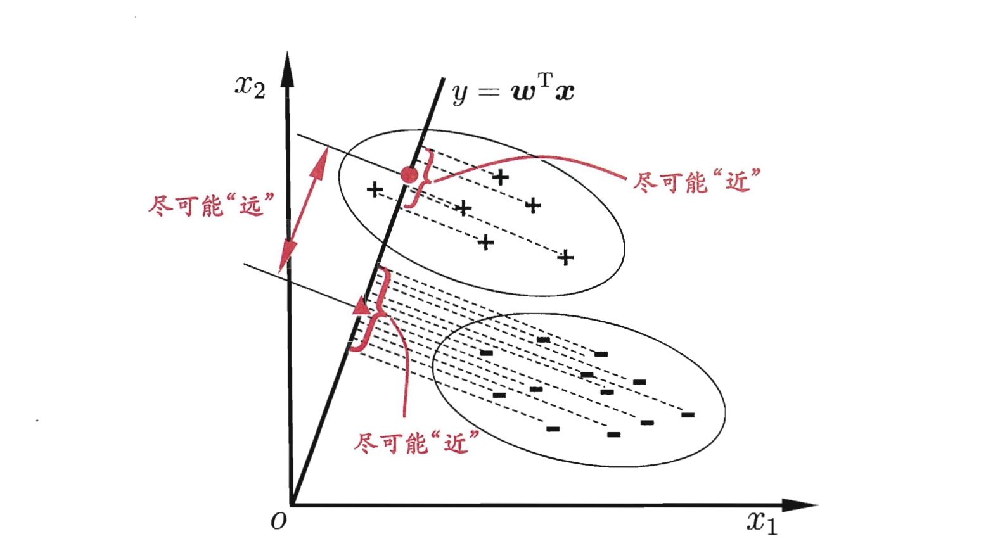
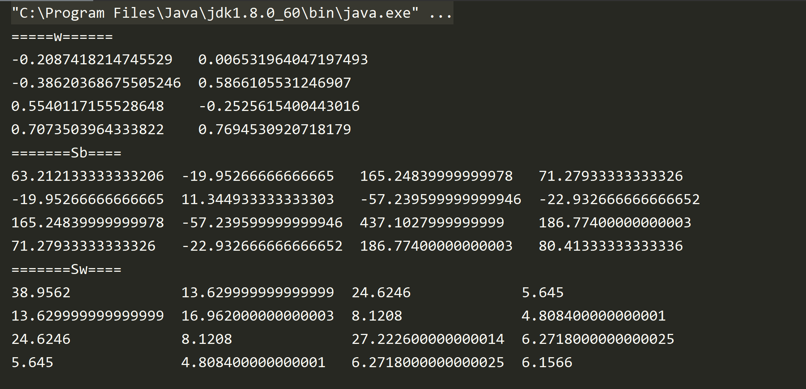
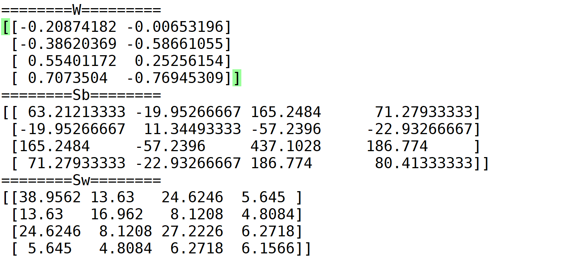

#### 1. 算法概述

LDA的思想可以用一句话概括，就是“投影后类内方差最小，类间方差最大”，如下图所示。我们要将数据在低维度上进行投影，投影后希望每一种类别数据的投影点尽可能的接近，而不同类别的数据的类别中心之间的距离尽可能的大。



#### 2. 算法推导

LDA多分类：假定存在$N$个类，且第$i$类示例树为$m_i$,我们定义全局散度矩阵：
$$
S_t = S_b + S_w= \sum_{i= 1}^{m}(x_i - \mu)(x_i - \mu)^T
$$
其中$\mu$是所有示例的均值向量。将类内散度矩阵$S_w$定义为每个类别的散度矩阵之和，即
$$
S_w = \sum_{i=1}^{N}S_{w_i}
$$
其中
$$
S_{w_i} = \sum_{x \in X_i}(x - \mu_i)(x - \mu_i)^T
$$
由式$(1)-(3)$可得：
$$
S_b = S_t - S_w = \sum_{i=1}^{N}(\mu_i - \mu)(\mu_i - \mu)^T
$$
多分类LDA有多种实现方式：使用$S_b,S_w,S_t$中的任意两即可。常见的一种实现是采用优化目标
$$
\max_W \dfrac{tr(W^TS_bW)}{tr(W^{T}S_wW)}
$$
其中$W \in R^{d\times(N-1)}$,$tr(.)$表示矩阵的迹。式$(5)$可以通过求解如下式的广义特征问题
$$
S_bW = \lambda S_wW
$$
$W$的闭式解则是$S_w^{-1}S_b$的N-1个广义特征值所对应的特征向量组成的矩阵。

​		若将$W$视为一个投影矩阵，则多分类LDA将样本矩阵投影到$N-1$维空间。$N-1$通常原小于数据原来的维数，且投影过程中使用了类别信息，因此LDA也被视为一种数据降维的技术。

#### 3. 实现步骤

1. 对于每一类别，计算$d$维数据的均值向量；
2. 构造类间散度矩阵$S_b$和类内散度矩阵$S_w$;
3. 计算矩阵$S_w^{-1}S_b$的特征值及对应的特征向量；
4. 选取前$k$特征值所对应的特征向量，构造$d \times k$维的转换矩阵$W$,其中特征值以列的形式排列；
5. 使用转换矩阵$W$将样本映射到新的特征子空间上。

#### 4. LDA与PCA

LDA和PCA都可以用作降维技术，下面比较一下相同点和不同点：

##### 4.1 相同点

​	1）两者均可以对数据进行降维;

​	2）两者在降维时均使用了矩阵特征分解的思想;

​	3）两者都假设数据符合高斯分布.

##### 4.2 不同点

​	1） LDA是有监督的降维技术，PCA是无监督的降维技术；

​	2） LDA还可以用于分类，后续在分类时，贴上分类的处理方法；

​	3） LDA最多可降低到$k$维（$k$是分类的个数),而PCA最多可降低到$n-1$维（$n$是数据的维数)；

​	4） LDA选择分类性能最好的投影方向，而PCA选择样本点投影具有最大方差的方向。

#### 5.  LDA的实现代码

##### 5.1 Scala lda实现

```scala
package ml.scrath.lda

import breeze.linalg._
import breeze.stats._
import org.apache.spark.rdd.RDD

class LinearDiscriminantAnalysis extends Serializable {

  def fit(data: RDD[DenseVector[Double]], labels: RDD[Int],k:Int) = {
    val sample = labels.zip(data)
    computeLDA(sample,k)
  }

  def computeLDA(dataAndLabels: RDD[(Int, DenseVector[Double])],k:Int)= {

    val featuresByClass = dataAndLabels.groupBy(_._1).values.map(x => rowsToMatrix(x.map(_._2)))
    val meanByClass = featuresByClass.map(f => mean(f(::, *))) // 对行向量求平均值 each mean is a row vector, not col

    //类内散度矩阵
    val Sw = featuresByClass.zip(meanByClass).map(f => {
      val featuresMinusMean: DenseMatrix[Double] = f._1(*, ::) - f._2.t // row vector, not column
      featuresMinusMean.t * featuresMinusMean: DenseMatrix[Double]
    }).reduce(_+_)

    val numByClass = featuresByClass.map(_.rows : Double)
    val features = rddToMatrix(dataAndLabels.map(_._2))
    val totalMean = mean(features(::, *)) // A row-vector, not a column-vector

    val Sb = meanByClass.zip(numByClass).map {
      case (classMean, classNum) => {
        val m = classMean - totalMean
        (m.t * m : DenseMatrix[Double]) :* classNum : DenseMatrix[Double]
      }
    }.reduce(_+_)

    val eigen = eig((inv(Sw): DenseMatrix[Double]) * Sb)

    val eigenvectors = (0 until eigen.eigenvectors.cols).map(eigen.eigenvectors(::, _).toDenseMatrix.t)

    val topEigenvectors = eigenvectors.zip(eigen.eigenvalues.toArray).sortBy(x => -scala.math.abs(x._2)).map(_._1).take(k)
    val W = DenseMatrix.horzcat(topEigenvectors:_*)
    (W,Sb,Sw)
  }

  def rowsToMatrix(in: TraversableOnce[DenseVector[Double]]): DenseMatrix[Double] = {
    rowsToMatrix(in.toArray)
  }

  def rowsToMatrix(inArr: Array[DenseVector[Double]]): DenseMatrix[Double] = {
    val nRows = inArr.length
    val nCols = inArr(0).length
    val outArr = new Array[Double](nRows * nCols)
    var i = 0
    while (i < nRows) {
      var j = 0
      val row = inArr(i)
      while (j < nCols) {
        outArr(i + nRows * j) = row(j)
        j = j + 1
      }
      i = i + 1
    }
    val outMat = new DenseMatrix[Double](nRows, nCols, outArr)
    outMat
  }


  def rddToMatrix(inArr1: RDD[DenseVector[Double]]): DenseMatrix[Double] = {
    val inArr = inArr1.collect()
    val nRows = inArr.length
    val nCols = inArr(0).length
    val outArr = new Array[Double](nRows * nCols)
    var i = 0
    while (i < nRows) {
      var j = 0
      val row = inArr(i)
      while (j < nCols) {
        outArr(i + nRows * j) = row(j)
        j = j + 1
      }
      i = i + 1
    }
    val outMat = new DenseMatrix[Double](nRows, nCols, outArr)
    outMat
  }
}
```

##### 5.2 scala 测试代码

测试代码（其中数据iris.csv是由下面python代码生成）

```scala
package ml.scrath.lda

import org.apache.spark.sql.SparkSession
import breeze.linalg.DenseVector

object TestLDA extends App {

  val spark =
    SparkSession.builder()
      .appName("DataFrame-Basic")
      .master("local[4]")
      .config("spark.sql.warehouse.dir", "file:///E:/spark-warehouse")
      .getOrCreate()
  val sc = spark.sparkContext
  val irisData = sc.textFile("D:\\data\\iris.csv")

  val trainData = irisData.map {
    _.split(",").dropRight(1).map(_.toDouble)
  }.map(new DenseVector(_))

  val labels = irisData.map {
    _.split(",").apply(4).map(_.toInt).apply(0)
  }

  val start = System.currentTimeMillis()
  val model = new LinearDiscriminantAnalysis
  val k = 2
  val res = model.fit(trainData, labels, k)

  println("=====W======")
  println(res._1)
  println("=======Sb====")
  println(res._2)
  println("=======Sw====")
  println(res._3)

}
```

##### 5.3 scala 结果

展示转换矩阵$W$, 类间散度矩阵$S_b$和类内散度矩阵$S_w$



##### 5.4 Python lda 代码

```python
import numpy as np
from sklearn.datasets import load_iris
import matplotlib.pyplot as plt
from sklearn.discriminant_analysis import LinearDiscriminantAnalysis


def LDA(X, y, k):
    '''
    X为数据集，y为label，k为目标维数
    '''
    label_ = np.unique(y)
    mu = np.mean(X, axis=0)

    Sw = np.zeros((len(mu), len(mu)))  # 计算类内散度矩阵
    for i in label_:
        _X = X[y == i]
        _mean = np.mean(_X, axis=0)
        Sw += np.dot((_X - _mean).T,
                     _X - _mean)

    print(Sw)
    
    Sb = np.zeros((len(mu), len(mu)))  # 计算类内散度矩阵
    for i in label_:
        _X = X[y == i]
        _mean = np.mean(_X, axis=0)
        Sb += len(_X) * np.dot(( _mean - mu).reshape(
            (len(mu), 1)), (_mean - mu).reshape((1, len(mu))))
        
    print(Sb)

    eig_vals, eig_vecs = np.linalg.eig(np.linalg.inv(Sw).dot(Sb))  # 计算Sw-1*Sb的特征值和特征矩阵

    sorted_indices = np.argsort(eig_vals)
    topk_eig_vecs = eig_vecs[:, sorted_indices[:-k - 1:-1]]  # 提取前k个特征向量
    return topk_eig_vecs,Sb,Sw


if '__main__' == __name__:

    iris = load_iris()
    X = iris.data
    y = iris.target

## 将数据写出到iris.csv文件，供scala使用，保证数据的一致性。
    data_cat =  np.c_[X,y]
    import pandas
    iris_df = pandas.DataFrame(data_cat)
    iris_df.to_csv("iris.csv",index = 0,header = False)

    W,Sb,Sw = LDA(X, y, 2)
    X_new = np.dot((X), W)
    plt.figure(1)
    plt.scatter(X_new[:, 0], X_new[:, 1], marker='o', c=y)
    
    print("========W=========")
    print(W)
    print("========Sb========")
    print(Sb)
    print("========Sw========")
    print(Sw)
    
    
    # 与sklearn中的LDA函数对比
    lda = LinearDiscriminantAnalysis(n_components=2)
    lda.fit(X, y)
    X_new = lda.transform(X)
#    print(X_new)
    plt.figure(2)
    plt.scatter(X_new[:, 0], X_new[:, 1], marker='o', c=y)
    plt.show()

```

##### 5.5 Python 结果

展示转换矩阵$W$, 类间散度矩阵$S_b$和类内散度矩阵$S_w$,可见scala和python得到结果是一致的。



