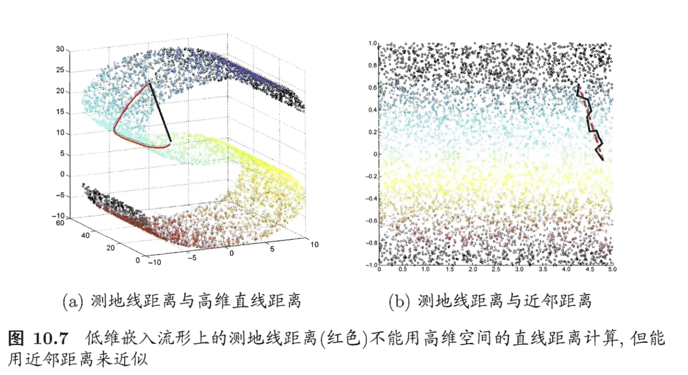
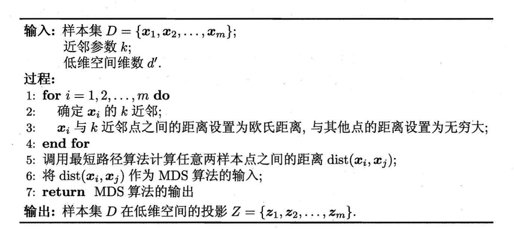
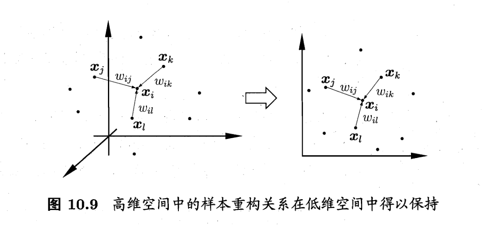
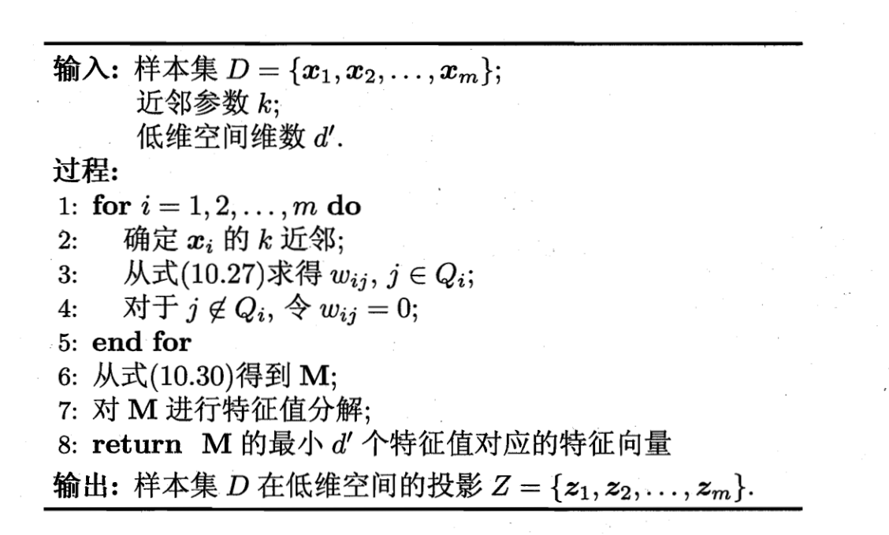
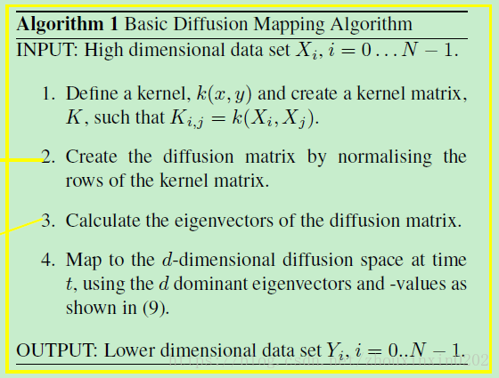

#### 1. 降维概述

样本的特征数称为维数（dimensionality），当维数非常大时，也就是现在所说的“维数灾难”，具体表现在：在高维情形下，数据样本将变得十分稀疏，因为此时要满足训练样本为“密采样”的总体样本数目是一个触不可及的天文数字，谓可远观而不可亵玩焉...训练样本的稀疏使得其代表总体分布的能力大大减弱，从而消减了学习器的泛化能力；同时当维数很高时，计算距离也变得十分复杂，甚至连计算内积都不再容易，这也是为什么支持向量机（SVM）使用核函数“低维计算，高维表现”的原因。

缓解维数灾难的一个重要途径就是降维，即通过某种数学变换将原始高维空间转变到一个低维的子空间。在这个子空间中，样本的密度将大幅提高，同时距离计算也变得容易。这时也许会有疑问，这样降维之后不是会丢失原始数据的一部分信息吗？这是因为在很多实际的问题中，虽然训练数据是高维的，但是与学习任务相关也许仅仅是其中的一个低维子空间，也称为一个低维嵌入，例如：数据属性中存在噪声属性、相似属性或冗余属性等，对高维数据进行降维能在一定程度上达到提炼低维优质属性或降噪的效果。

#### 2.降维方法分类

#### 3 线性方法

##### 3.1 PCA主成分分析

主成分分析（PCA）直接通过一个线性变换，将原始空间中的样本投影到新的低维空间中。简单来理解这一过程便是：PCA采用一组新的基来表示样本点，其中每一个基向量都是原来基向量的线性组合，通过使用尽可能少的新基向量来表出样本，从而达到降维的目的。

假设使用$d^{’}$个新基向量来表示原来样本，实质上是将样本投影到一个由$d^{’}$个基向量确定的一个超平面上（即舍弃了一些维度），要用一个超平面对空间中所有高维样本进行恰当的表达，最理想的情形是：若这些样本点都能在超平面上表出且这些表出在超平面上都能够很好地分散开来。但是一般使用较原空间低一些维度的超平面来做到这两点十分不容易，因此我们退一步海阔天空，要求这个超平面应具有如下两个性质：

> **最近重构性**：样本点到超平面的距离足够近，即尽可能在超平面附近；
> **最大可分性**：样本点在超平面上的投影尽可能地分散开来，即投影后的坐标具有区分性。

PCA的算法描述如下：

##### 3.2 LDA 线性判别分析

参考之前的博文

#### 4 非线性方法

##### 4.1 MDS 

不管是使用核函数升维还是对数据降维，我们都希望**原始空间样本点之间的距离在新空间中基本保持不变**，这样才不会使得原始空间样本之间的关系及总体分布发生较大的改变。**“多维缩放”（MDS）**正是基于这样的思想，**MDS要求原始空间样本之间的距离在降维后的低维空间中得以保持**。

假定$m$个样本在原始空间中任意两两样本之间的距离矩阵为$D \in R ^{m \times m}$，其中第$i$行$j$列的元素$dist_{ij}$为样本$x_i$到$x_j$的距离。我们的目标便是获得样本在低维空间中的表示$Z \in R^{d^{’} \times m} $, $d'< d$，且任意两个样本在低维空间中的欧式距离等于原始空间中的距离，即$||zi-zj||=dist_{ij}$。因此接下来我们要做的就是根据已有的距离矩阵$D$来求解出降维后的坐标矩阵$Z$。

令降维后的样本坐标矩阵Z被中心化，**中心化是指将每个样本向量减去整个样本集的均值向量，故所有样本向量求和得到一个零向量**。这样易知：矩阵B的每一列以及每一列求和均为0，因为提取公因子后都有一项为所有样本向量的和向量。

令$B = Z^TZ \in R^{m \times m}$,其中$B$为降维后的样本的內积矩阵，$b_{ij} = z_i^Tz_j$,有：
$$
dist_{ij}^{2} = ||z_i||^2 + ||z_j||^2 -2z_i^Tz_j
= b_{ii} + b_{jj} - 2b_{ij}
$$
为了方便讨论，令降维后的样本$Z$被中心化，即$\sum_{i=1}^{m}z_i = 0$,显然$B$的行与列之和均为0，即$\sum_{i=1}^{m}b_{ij} =\sum_{j=1}^{m}b_{ij} =  0$,容易知道：
$$
\sum_{i=1}^{m}dist_{ij}^2 = tr(B) +mb_{jj}
$$

$$
\sum_{j=1}^{m}dist_{ij}^2 = tr(B) +mb_{ii}
$$

$$
\sum_{i=1}^m\sum_{i=1}^{m}dist_{ij}^2 = 2m * tr(B)
$$

其中$tr(.)$表示矩阵的迹(trace),$tr(B) = \sum_{i=1}^{m}||z_i||^2$,令
$$
dist_{i.}^2=\sum_{i=1}^{m}dist_{ij}^2
$$

$$
dist_{.j}^2=\sum_{i=1}^{m}dist_{ij}^2
$$

$$
dist_{..}^2=\frac{1}{m^2}\sum_{i=1}^{m}\sum_{i=1}^{m}dist_{ij}^2
$$

由上面三个等式可知：
$$
b_{ij} = -0.5(dist_{ij}^2 - dist_{i.}^2 -dist_{.j}^2 + dist_{..}^2)
$$
通过降维前后保持不变的距离矩阵$D$求取內积矩阵$B$.

对$B$做特征值分解(**eigenvalue decompostion**), $B = VUV^T$,其中$U=diag(\lambda _1,\lambda _2,...,\lambda _d)$为特征值构成的对角矩阵，$\lambda _1 \geq \lambda _2 \geq ... \geq \lambda _d$,$V$为特征向量矩阵。假定其中有$d^{\\*}$个非零特征值，他们构成的对角矩阵 $U_{\\*} = diag(\lambda _1,\lambda _2,...,\lambda _{d^{\\*}})$ ,其中$V_*$表示对应的特征向量矩阵，则$Z$可以表示为：
$$
Z = U_*^{\frac{1}{2}}V_*^T \in R^{d^*\times m}
$$
MDS 的算法描述如下：

##### 4.2 Isomap

等度量映射（Isomap)属于流行学习，流形学习（manifold learning）是一种借助拓扑流形概念的降维方法**，**流形是指在局部与欧式空间同胚的空间，即在局部与欧式空间具有相同的性质，能用欧氏距离计算样本之间的距离。这样即使高维空间的分布十分复杂，但是在局部上依然满足欧式空间的性质，基于流形学习的降维正是这种**“邻域保持”**的思想 ，等度量映射（Isomap）试图在降维前后保持邻域内样本之间的距离，而局部线性嵌入（LLE）则是保持邻域内样本之间的线性关系。

等度量映射的基本出发点是：高维空间中的直线距离具有误导性，因为有时高维空间中的直线距离在低维空间中是不可达的。**因此利用流形在局部上与欧式空间同胚的性质，可以使用近邻距离来逼近测地线距离**，即对于一个样本点，它与近邻内的样本点之间是可达的，且距离使用欧式距离计算，这样整个样本空间就形成了一张近邻图，高维空间中两个样本之间的距离就转为最短路径问题。可采用著名的**Dijkstra算法**或**Floyd算法**计算最短距离，得到高维空间中任意两点之间的距离后便可以使用MDS算法来其计算低维空间中的坐标。

从**MDS**算法的描述中我们可以知道：MDS先求出了低维空间的内积矩阵$B$，接着使用特征值分解计算出了样本在低维空间中的坐标，但是并没有给出通用的投影向量$w$，因此对于需要降维的新样本无从下手，书中给出的权宜之计是利用已知高/低维坐标的样本作为训练集学习出一个“投影器”，便可以用高维坐标预测出低维坐标。

ISOMAP的算法步骤如下：

对于近邻图的构建，常用的有两种方法：**一种是指定近邻点个数**，像**KNN**一样选取k个最近的邻居；**另一种是指定邻域半径**，距离小于该阈值的被认为是它的近邻点。但两种方法均会出现下面的问题：

> 若**邻域范围指定过大，则会造成“短路问题”**，即本身距离很远却成了近邻，将距离近的那些样本扼杀在摇篮。
> 若**邻域范围指定过小，则会造成“断路问题”**，即有些样本点无法可达了，整个世界村被划分为互不可达的小部落。

##### 4.3 LLE 

不同于Isomap算法去保持邻域距离，LLE算法试图去保持邻域内的线性关系，假定样本$x_i$的坐标可以通过它的邻域样本线性表出：
$$
x_i = w_{ij}x_j + w_{ik}x_k + w_{il}x_l
$$
LLE希望上式的关系在低维空间中得以保持。

LLE先为每个样本$x_i$找到其近邻下标集合$Q_i$,然后计算基于$Q_i$中的样本点对$x_i$进行线性重构的系数$w_i$.
$$
\min_{w_1,w_2,...,w_m}\sum_{i=1}^m||x_i - \sum_{j \in Q_i}w_{ij}{x_j}||_2^2
$$

$$
s.t. \sum_{j\in Q_i}w_{ij} = 1
$$

其中$x_i$和$x_j$均为已知，令$C_{jk} = (x_i- x_j)^T(x_i-x_j)$,$w_{ij}$有闭式解
$$
w_{ij} = \frac{\sum_{k \in Q_i}C_{jk}^{-1}}{\sum_{l,s \in Q_i}C_{ls}^{-1}}
$$
**LLE**在低维空间中保持$w_i$不变，于是$x_i$对应的低维空间坐标$z_i$可通过下式求解：
$$
\min_{z_1,z_2,...,z_m}\sum_{i=1}^m||z_i - \sum_{j \in Q_i}w_{ij}{z_j}||_2^2
$$
上式需要确定的是$x_i$对应的低维空间坐标$z_i$.

令$Z =(z_1,z_2,...,z_m) \in R^{d'\times m}$,$(W)_{ij} = w_{ij}$,
$$
M = (I-W)^T(I-W)
$$
则优化目标可以重写为下式：
$$
\begin{equation}
\min_z tr(ZMZ^T) \\
s.t. ZZ^T = I 
\end{equation}
$$
可以通过特征值分解求解，$M$最小的$d'$的特征值对应的特征向量组成的矩阵即为$Z^T$

LLE算法步骤如下：

##### 4.4 核PCA kernel PCA

说起机器学习你中有我/我中有你/水乳相融...在这里能够得到很好的体现。正如SVM在处理非线性可分时，通过引入核函数将样本投影到高维特征空间，接着在高维空间再对样本点使用超平面划分。这里也是相同的问题：若我们的样本数据点本身就不是线性分布，那还如何使用一个超平面去近似表出呢？因此也就引入了核函数，**即先将样本映射到高维空间，再在高维空间中使用线性降维的方法**。下面主要介绍**核化主成分分析（KPCA）**的思想。

若核函数的形式已知，即我们知道如何将低维的坐标变换为高维坐标，这时我们只需先将数据映射到高维特征空间，再在高维空间中运用PCA即可。但是一般情况下，我们并不知道核函数具体的映射规则，例如：Sigmoid、高斯核等，我们只知道如何计算高维空间中的样本内积，这时就引出了KPCA的一个重要创新之处：**即空间中的任一向量，都可以由该空间中的所有样本线性表示**。

假定我们将在高维特征空间中的数据投影到由$W$确定的超平面上，即PCA欲求解
$$
(\sum_{i=1}^mz_iz_i^T)W = \lambda W
$$
其中$z_i$是样本点$x_i$在高维特征空间的像，可知：
$$
W = \frac{1}{\lambda}(\sum_{i=1}^mz_iz^T_i)W = \sum_{i=1}^m z_i\frac{z_i^TW}{\lambda} \\
=\sum_{i=1}^m z_i\alpha _i
$$
其中$\alpha _i = \frac{1}{\lambda}z_i^TW$.假定$z_i$是由原始属性空间中的样本点$x_i$通过映射$\phi$产生，即$z_i = \phi (x_i),i= 1,2,...,m$,若$\phi$能被显式的表达出来，则通过它将样本映射至高维特征空间，再在特征空间中实施PCA即可。

即（17）可变为
$$
(\sum_{i=1}^m \phi (x_i) \phi (x_i)^T)W = \lambda W
$$
（18）式可变为：
$$
W= \sum_{i=1}^m \phi(x_i)\alpha_i
$$
一般情形下，我们不清楚$\phi$的具体形式，于是引入核函数:
$$
\kappa(x_i,x_j) = \phi(x_i)^T\phi(x_j)
$$
将（21)(20)带入到(19)式中可得：
$$
KA= \lambda A
$$
其中$K$为$\kappa$ 对应的核矩阵，$(K)_{ij} = \kappa(x_i,x_j),A = (\alpha_1;\alpha_2;...;\alpha_m)$,显然上式是个特征值分解问题，取$K$最大的$d'$个特征值对应的特征向量即可。

##### 4.5 DiffusionMap

扩散映射是一种降维方法

1. 其通过 整合数据的局部几何关系 揭示 数据集在不同尺度的几何结构。
2. 与PCA (principal component analysis)、MDS (Multidimensional Scaling) 这些降维方法相比，扩散映射 非线性，聚焦于发现数据集潜在的流形结构。
3. 优点：对噪声鲁棒，计算代价较低

算法步骤如下:

